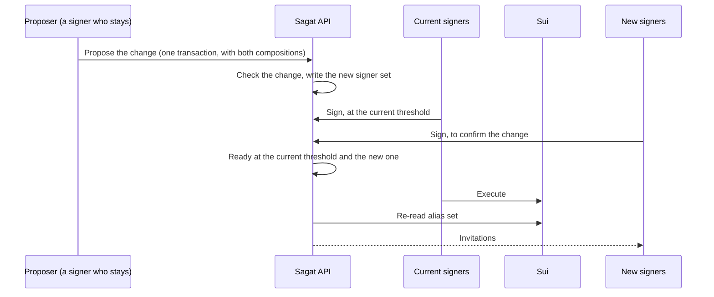

# Account rotation

_Design. First drafted 2026-09-28, redone 2026-11-17 against main and the designer's "Change signers" screens, after the schema rename, the services extraction and the audit log shipped. Every rule below was decided or confirmed on 2026-11-17 unless it carries another date; who acts for an account and how a key accepts one were redone on 2026-11-19. The protocol behaviour was validated on localnet on 2026-10-14, see the spike results in [research/address-aliases.md](research/address-aliases.md)._

## Goal

Let a team change who controls a multisig account (members, weights, threshold) **without changing the account's address**. Assets, SuiNS names, `UpgradeCap`s and integrations stay where they are.

This uses Sui address aliases: the account adds the address of a new composition to its alias set and removes the old one, and the new composition then signs transactions whose sender is the account.

## The design in short

- A signer change is **one proposal**. The signers of the set it replaces approve it at their threshold. When it executes, the new signers replace the old ones at once, on that network.
- An account can have **several signer sets** on a network: every signer set in its alias set that Sagat can identify acts for it. An alias it cannot identify is listed with a warning. Nearly every account has one set.
- The **original signer set stays readable** for every account. The address is derived from it, so it is the proof of the address, and the app checks it whatever acts now.
- New signers who signed the change are **accepted when** it is recorded as executed, with no invitation; those who did not are **invited after** it executes. A key agrees to an account, not to a composition, by accepting it or by signing the change that adds it, so nobody becomes a signer of an account they never agreed to.
- A change is ready once the set it replaces reaches its threshold and the new set's signers, staying or new, have signed it for the new threshold. Only the replaced set's signatures go to the chain. The app counts the new set's part itself and does not offer to execute the change until the new set has signed for its own threshold.
- The transaction carries both compositions, so anyone can check what it does without Sagat.
- Everything follows a network: rights, the list of accounts, the signers shown.

## Status

| Part                                                                                                    | State                                                                                                                                                                                                                                                                                                                                                                                                                                                                                                                                                                                                                                                                                                                                                                                                                                                                                                              |
| ------------------------------------------------------------------------------------------------------- | ------------------------------------------------------------------------------------------------------------------------------------------------------------------------------------------------------------------------------------------------------------------------------------------------------------------------------------------------------------------------------------------------------------------------------------------------------------------------------------------------------------------------------------------------------------------------------------------------------------------------------------------------------------------------------------------------------------------------------------------------------------------------------------------------------------------------------------------------------------------------------------------------------------------ |
| Schema: accounts, signer sets, `account_signer_sets`, the alias mirror tables, `proposals.executed_via` | Shipped in 0009. The refresh writes the mirror tables. Verify writes `executed_via` on both route sets, and so does the refresh when it settles a proposal. `account_acceptances` shipped in 0012, and the `/v1` accept and reject write it for a key outside the account's original set.                                                                                                                                                                                                                                                                                                                                                                                                                                                                                                                                                                                                                          |
| Alias helpers and the localnet spike                                                                    | Shipped: the derive and decode helpers and the transaction builders in `sdk/src/aliases.ts`, the change builder and the composition note in `sdk/src/signer-change.ts`, and `api/test/address-aliases.test.ts`, which also shows that a change's note reads back unchanged after execution.                                                                                                                                                                                                                                                                                                                                                                                                                                                                                                                                                                                                                        |
| Request flows as services                                                                               | Shipped. Every membership check and tally takes a scope: the original set, or the acting sets of a network. Legacy routes ask for the original set, and the `/v1` routes ask for the acting sets. Legacy routes refuse a changed account with the 409, and their two listings leave it out. Every answer is for one account, and one that completes the original set marks every link to it `verified`.                                                                                                                                                                                                                                                                                                                                                                                                                                                                                                            |
| Key labels (0010) and the audit log (0011)                                                              | Shipped. The refresh writes the alias actions as system rows. Accept and reject are recorded: `signer_set.accepted` and `signer_set.rejected` from the legacy routes, `account.accepted` and `account.rejected` from `/v1`.                                                                                                                                                                                                                                                                                                                                                                                                                                                                                                                                                                                                                                                                                        |
| The app's own checks before showing or signing                                                          | Shipped. The original set must rebuild the address where it's shown. Each set shown is checked per network on the app's node; the app says when it could not. Accounts and invitations use the `/v1` routes. The members page shows every acting set, the original signers and other sets. Proposals are proposed, listed, read, signed, cancelled, verified and executed through the `/v1` routes, counted per set on the app's node and executed with the set that reached its threshold. The preview warns on a call to the alias module. The audit log verifier trusts the keys of every set that passes. A refused execution after a signer change refreshes the signers. A signer change's page lists what the change does, checked against the node's alias set, and holds Execute until the new set has signed for its threshold. Not built yet: the path from the original signers. See the app's checks. |
| Alias mirror and resolver                                                                               | The mirror, its refresh and the resolver are shipped. The `/v1` routes refresh before they decide: the reads fall back to the mirror and say it was not checked, and the writes are refused with the 503. Verify refreshes after a successful alias call, on both route sets. A refresh that sees the alias object changed settles the alias proposals it finds executed, and verify looks up a cancelled one. The legacy routes that refuse a changed account, and the two listings, refresh on every supported network before they decide: the reads and the listings fall back to the mirror, and the writes are refused with the 503.                                                                                                                                                                                                                                                                          |
| `/v1`                                                                                                   | Foundation, the account routes (list, read, invitations, accept and reject, proposers) and the proposal routes (create, list, read, vote, cancel and verify, by digest) shipped, with the signer changes and an open change on the account read, a transaction on the removed entries, and a proposal's signer change. No other route.                                                                                                                                                                                                                                                                                                                                                                                                                                                                                                                                                                             |
| Changing signers                                                                                        | Built in the API and SDK: a change recognised when it is created, with its checks, one at a time per account and network, the new set's rows and labels, who signs and cancels a change, the legacy routes not serving one, the key cap counting accounts, and an account made from a composition a change left. In the app: "Enable signer changes", the editor and the review from the members page, the change on its proposal page for a signer who stays, one it removes and one it adds, holding Execute until the new set has signed for its threshold, the members page's banner while a change is pending, and the notice to a removed signer. Not built: the cancelled state of a change, and the path from the original signers.                                                                                                                                                                        |

What follows needs no new migration. The table for a key's answer to an account shipped in 0012.

## Vocabulary

| Term                    | Meaning                                                                                                                                                                                                                   |
| ----------------------- | ------------------------------------------------------------------------------------------------------------------------------------------------------------------------------------------------------------------------- |
| **Account**             | The on-chain address that owns assets and is the `sender` of proposals. The interface calls it a pod.                                                                                                                     |
| **Signer set**          | A composition: public keys, weights, threshold, in order. Its address is derived from the composition, so it is immutable. Today's "multisig" row.                                                                        |
| **Original signer set** | The signer set whose derived address equals the account address, so its composition is the proof of that address. Always returned with the account. Not special in storage.                                               |
| **Alias set**           | The on-chain set of addresses allowed to sign for an account, **per network**. Defaults to `{account}` when the account never called `enable`.                                                                            |
| **Acting signer set**   | A signer set in the account's alias set on a network that Sagat can identify: a composition it holds, not a registered key alone. Each one can sign for the account. The interface calls their members the pod's signers. |
| **Other signer set**    | An address in the alias set on that network that Sagat cannot identify. It controls the account on chain like any acting set does.                                                                                        |
| **Signer change**       | A proposal that replaces one acting signer set with another on one network. The interface calls it "Change signers".                                                                                                      |
| **Mirror**              | The database copy of an account's alias set per network: `account_aliases` and `account_alias_state`.                                                                                                                     |
| **Changed**             | An account whose mirrored alias set is anything other than exactly `{account}` on at least one supported network. `enable` alone does not make it changed.                                                                |

## Rules the design relies on

1. **One hop.** The signer's address must be in the sender's alias set. The signer's own aliases are not consulted. _Confirmed on localnet, 2026-10-14._
2. **Leaves are public keys.** A multisig member signs with the exact key in the composition. A member's personal aliases never matter.
3. **Aliases are per network.** Changing signers on testnet does nothing on mainnet.
4. **Chain is the source of truth.** The alias set can change outside Sagat. The database only mirrors it.
5. **Signatures belong to keys, not to signer sets.** A member signs the transaction bytes with their own key. The signature is the same whichever signer set ends up combining it.
6. **Compositions are immutable.** There is no "edit signer set". A change is a new signer set, and so is a new order of the same keys.
7. **An address proves one composition.** An account's address is derived from its original signer set, and no later signer set rebuilds it. Checking that needs nothing from the chain.

## Data model

Shipped in 0009 to 0012, with the names of this doc.

```text
accounts            (address, name, created_at)
signer_sets         (address, threshold, is_verified, name)            name kept for legacy routes
signer_set_members  (signer_set_address, public_key, weight, order,
                     is_accepted, is_rejected)
account_proposers   (account_address, address, added_by, added_at)
proposals           (account_address, network, executed_via, ...)      executed_via written by verify and the refresh
proposal_signatures (proposal_id, public_key, signature)
account_aliases     (account_address, network, alias_address)          mirror of chain, written by the refresh
account_alias_state (account_address, network, exists,
                     observed_version, observed_at)                    one row per refreshed network
account_acceptances (account_address, public_key, is_accepted,
                     is_rejected, answered_at)                         0012; a key's answer to an account
account_signer_sets (account_address, signer_set_address, label,
                     status, drafted_by, created_at)                   account to signer set link
account_keys        (account_address, public_key, label,
                     updated_by, updated_at)                           0010; what an account calls a key
account_events      (id, account_address, network, actor, action,
                     subject, before, after, proof, created_at)        0011; audit log, see below
```

Alias entries are stored as **addresses**. The resolver classifies each at read time.

**`account_signer_sets` is the link between an account and a signer set** (decided 2026-10-15), one row per pair. A composition is content-addressed and can be shared by several accounts, so anything said about it on behalf of one account lives on the pair. Every account has a row for its original composition, `(A, A)`, written by the create route. A signer change writes the row for its new composition when the change is proposed, with the proposer in `drafted_by`. Whether a set is valid on a network is **not** stored here: it comes from the mirror. Nor does a link decide who acts: it only says the account has used or proposed that composition. Nothing reads the status: links are written `inviting`, and every link to `A` becomes `verified` once every member of the original set has accepted; `draft` and `abandoned` are not written by this design.

`account_alias_state` records what the last refresh saw on a network: whether the alias object exists, its version, and when it was read. It separates "never checked" (no state row) from "not changed" (`exists` is false). An account whose state row says the object does not exist has the alias set `{account}`. It has no `account_aliases` rows.

**`account_acceptances` holds a key's answer to an account** (decided 2026-11-19). Acceptance used to belong to a composition, and several accounts can share one, so a key that accepted one account counted as accepted in every account that later used the same composition. A key now answers per account. For a key of the account's original set the answer stays in the member row, as today, whichever route took it, so the legacy routes do not change. For a key of any other signer set of that account it is a row here.

Nothing stores which sets act, or where a signer change stands. A pending change is a pending proposal, an executed one is in the mirror, and both are read when needed.

## Acting signer sets

Aliases cannot be scoped: every address in the alias set has full control of the account. Sagat follows the chain (decided 2026-11-19): every alias it can identify acts for the account on that network, and the rest are shown.

- **An acting signer set** is an address in the account's alias set on a network that Sagat can identify: a composition it holds. Nothing is stored about which sets act. The answer is the mirror, read when needed. A set acts from the refresh that sees it added and stops at the refresh that sees it removed, however that happened: a change in Sagat, a transaction written by hand, or a removed set added back later.
- **Nearly every account has one.** A change swaps one set for another, so several sets act only when someone adds one outside the change flow, such as a recovery set.
- **Proposals are checked and counted against every acting set** of their network. A signature belongs to a key, so it counts in each set that holds the key. A proposal is ready when any one set reaches its own threshold, and it is executed with that set. `executed_via` records the address that actually signed for the sender, as it is, when the proposal is verified.
- **A key agrees to an account, not to a composition.** A member of an acting set who has not answered for that account is invited to it, and gets a member's rights when they accept. This is what keeps a stranger's account out of someone's list: anyone can add a known composition to the alias set of their own account, and its members then see an invitation that says who made the account, not an account of theirs. Signers who stay through a change have accepted the account already and are asked nothing.
- **Other signer sets** are the aliases Sagat cannot identify. They are listed on the members page with the warning that each can approve transactions from the address alone. Nobody gets access through them.
- **Any one set is enough.** Every acting set, and every other signer set, can move the account's assets alone. The members page says so wherever the alias set holds more than one address. A set that is itself an account shows that account's name and a link only to a viewer who is one of its signers.
- **No acting set.** If Sagat can identify no alias on a network, nobody can act for the account through Sagat there. The members page says the address is controlled by other signer sets and lists them.
- **The original signer set is always kept and returned** (decided 2026-11-19). An account's address is derived from its original composition and from nothing else, so that composition proves the address with no node and no trust in Sagat. Every read of an account returns it, on every network, whether it still acts or was removed. Once it is out of the alias set on a network it gives no access there: its keys read and sign nothing unless they are also in a set that acts.

## Signer resolver

One service answers "who signs for this account on this network". Routes and other services never read alias rows.

It classifies every address in the alias set:

| Kind         | When                                             | Result                                         |
| ------------ | ------------------------------------------------ | ---------------------------------------------- |
| `signer_set` | A composition Sagat knows hashes to the address. | An acting set, with its signers and threshold. |
| `unknown`    | Otherwise, a registered key's own address too.   | Another signer set with no details.            |

Every request names a network, and rights come from the acting sets on that network. Nothing uses "valid on any network". "Accepted" means the key has accepted the account.

| Action                               | Who                                                                                                                   |
| ------------------------------------ | --------------------------------------------------------------------------------------------------------------------- |
| List accounts                        | An accepted key of an acting set.                                                                                     |
| Read an account                      | A key of an acting set, whatever its answer, as today.                                                                |
| List an account's proposals          | An accepted key of an acting set.                                                                                     |
| Read a proposal by digest            | Anyone, as today.                                                                                                     |
| Create a proposal                    | An accepted key of an acting set, or a proposer of the account.                                                       |
| Vote                                 | A key of an acting set, accepted or not, as today. For a signer change, also a key of the set it adds.                |
| Cancel                               | An accepted key of an acting set, or the external proposer while nobody has signed.                                   |
| Verify by digest                     | Anyone: it only reads the chain.                                                                                      |
| Add or remove a proposer             | An accepted key of an acting set. Removing cancels that proposer's proposals on that network, except a signer change. |
| Anything that calls the alias module | As for any proposal, one at a time. See changing signers.                                                             |
| Answer for an account                | A key of an acting set of that account. For an account's original set, a key of that composition, as today.           |

The services take the acting sets where they take the composition at the account's address today. For an account that never changed there is one, and it is that composition.

The resolver also returns the account's original set, which is the signer set at the account's own address. It takes no part in any access decision.

## Alias mirror and refresh

There is no background job and no dependency on a chain indexer. The API reads the alias state itself through one refresh function, which updates the mirror and returns what changed. A chain watcher can call the same function later.

**When.** Any decision that depends on who signs for an account refreshes first when the state row of that network is missing or older than 60 seconds, and decides on the result. That covers opening an account or a list, creating, signing and cancelling a proposal, and the legacy routes. A refresh also runs right after a proposal that calls `0x2::address_alias` is verified as executed. A key removed from the alias set outside Sagat therefore loses access within a minute.

**Read.** One derived-object read per account and network. Reads go through one loader per network, shared across requests, that collects the reads of 50 ms into batches of 50 and sends each account once per batch. It has no cache, so a refresh is never answered from a read made before it was asked for. A list of accounts therefore costs one `getObjects` call per 50 accounts. `getObjects` returns an error per object, so one bad read fails only its own account.

**Write.** The chain is read before any transaction opens.

- Unchanged: when the read shows the same existence and version as the state row, one statement moves `observed_at` forward, conditional on that version. No lock, no transaction.
- Changed, or no state row: one transaction per account. It takes the account lock (`lockAccount`), reads the state row again, applies the guard below, replaces the state row and alias rows, records the difference in the audit log, and settles the alias proposals it found executed on chain, below. The account lock is the one `recordAccountEvent` takes. A request that writes several accounts in one transaction takes their locks in sorted order, and a flow that also locks a `signer_sets` row takes that one first.

The difference is between effective sets: no alias rows counts as `{account}`, so the first refresh after `enable` reports no change.

**Settling alias proposals executed outside Sagat's view.** A proposal that calls the alias module can execute without anyone verifying it in Sagat, also after it was cancelled in Sagat, since a cancel is recorded in Sagat only and signatures released before it still combine. While a pending one stays pending it blocks the next change. So whenever a refresh sees the alias object changed, it also looks up on chain every proposal of that account and network that calls the alias module and has no on-chain outcome in Sagat: the pending ones, and every cancelled one, whatever its expiration, because a transaction that executed before its expiration can be discovered at any later refresh. There is at most one pending proposal per account and network, by the one-at-a-time rule; cancelled ones can be many. Each one found on chain is recorded as succeeded or failed, as verifying it would, whatever its status in Sagat was, so a cancelled proposal that executed takes its on-chain outcome in place of cancelled, with `executed_via`. One that is not found keeps its status. This happens in the transaction that writes the mirror. Nothing else depends on it: who acts comes from the alias set alone, so the order in which Sagat learns of executions does not matter, and a change that executed and failed changes nothing. These lookups happen before the transaction opens, like the alias read.

**Never backwards.** If a fullnode serves an older object version than the mirror holds, the refresh writes nothing and `observed_at` does not move. The same holds when the node reports the alias object as missing after a refresh saw it: the object cannot be deleted, so the node is lagging or wrong. A stale read can therefore never give access back to a removed signer set. The decision is then made on the mirror as it is.

**When a refresh fails.** Anything that writes (create, vote, cancel, proposers) is refused with a 503 naming the account and network. A list falls back to the mirror as it is and marks the account as not checked, so one bad read does not empty the list.

**Not mirrored.** The order of aliases: the mirror returns them sorted by address, the chain keeps insertion order.

**Networks that reset (decided 2026-10-15, confirmed 2026-11-17).** Devnet and localnet start over from genesis, and afterwards the alias object is missing or back at a lower version, so the guard keeps the old mirror. This is accepted as a development-only limitation. After a reset, stop every API instance, run `BEGIN; DELETE FROM account_aliases WHERE network = '<network>'; DELETE FROM account_alias_state WHERE network = '<network>'; COMMIT;`, and start the API again. Stopping first matters: a refresh in flight can read the old chain and write after the cleanup. Mainnet and testnet never reset.

## Changing signers



### 0. Enable signer changes (once per network)

The alias object does not exist until the account calls `address_alias::enable`, and a change needs it as an input, so `enable` cannot share a transaction with the first change. The spike confirmed a combined transaction fails to build.

- The members page offers "enable signer changes" at any time: an ordinary proposal that calls `enable`, approved like any other. It changes nothing by itself: the alias set stays `{account}` and the account does not count as changed.
- A change started before that step was done begins with it.
- The account needs SUI on that network to pay for it.
- This step is kept apart from the change flow so that it can be removed if the protocol later lets the two share a transaction.

### 1. Edit and review

The editor starts from an acting set the proposer is a signer of and produces a new composition: add, remove or replace a signer, change a weight, change the threshold, reorder. Its rules, as the screens draw them:

- A change is refused when nothing differs, when fewer than 2 or more than 10 signers remain, and when the threshold cannot be reached by the signers left.
- A threshold that one signer can meet alone is a warning, not an error.
- A signer cannot remove themselves. Someone who stays proposes it.
- The review tells the proposer that new signers confirm the change by signing it, and that the link should be shared with them.

Names typed for new signers are saved as key labels when the change is proposed. Renaming an existing signer is not part of this.

### 2. Propose

One transaction with `sender = account`:

- `address_alias::add(new set)` and `address_alias::remove(old set)`, both top-level commands. `add` comes first, because the last alias cannot be removed, unless the alias set is full, in which case `remove` comes first. A signer change always adds a set: the builder refuses a new composition that is already an alias, and a note on a change that adds none does not check. Removing a set without adding one is a hand-written alias proposal, with its warning, and its readiness waits for no new set.
- The composition note, below.
- An expiration that names the chain, so bytes built for one network cannot be presented as another's. A change expires at the end of the epoch after the one it was built in, about two days: that is the longest expiration the node accepts when the gas is paid from the account's address balance and the transaction then has no address-owned input, and the builder sets it whichever way the gas is paid. The API refuses a change that would expire later. A change that expired is proposed again. Sagat has no expired status, so an expired change stays listed as pending, but the one-at-a-time rule no longer counts an alias proposal whose expiration epoch has passed.

The alias object is party-owned, so consensus orders the transactions that touch it and its version never goes stale in a pending proposal. When the gas is a coin, it is an owned object, so the existing gas-coin collision check applies as for any proposal.

When the proposal is created, the API refreshes the mirror before it opens a transaction, and then, in one transaction under the account lock:

- requires the old set in the transaction to be an acting set of the account, read from the mirror under the lock;
- checks the note and the editor's rules above, again;
- requires the proposer to be an accepted signer of the old set who stays;
- refuses the proposal while another pending proposal of that account and network calls the alias module: **one change at a time per account and network**;
- writes the new signer set, its members and its link to the account. Signers who stay have accepted the account and are asked nothing. New keys that signed the change are accepted when it is recorded as executed; the others are invited once the set acts. A composition that already exists is linked as it is.

### 3. Sign

The signers of the set being replaced sign at its threshold. Sagat counts only that set for a change: another acting set's signatures would satisfy the chain, but a set is replaced by its own signers. **A change is ready when that set reaches its threshold and the new set's signers have signed it for theirs**, and its signatures are returned like any proposal's. A signer who is being removed can still sign, and their signature counts toward the set being replaced.

A key of the set the change adds may sign it too. Its signature is checked over the bytes and stored like any other, but it never counts toward the threshold of the set being replaced and never goes to the chain: it shows that the key is live and saw this exact change, and it can be what makes the change ready. A key in neither set is refused.

The new set's part is the SDK's `signerChangeProof`: the members of a new set whose keys signed, whether they stay or are new, must meet its threshold by their new weights. On `/v1`, `ready` stays false until they do; nothing is withheld. The app counts the same itself, with the new set read from the checked bytes, never from the API's `signerChange`. The proposal page shows that count beside the current signers' count, and does not offer Execute, or Execute after signing, until it reaches the threshold; one line names who still has to sign. This replaces the earlier warning that blocked nothing. It applies only to a change that checks: a hand-written or unchecked alias proposal keeps the generic warning and blocks nothing.

The page opens from its link for a key the change adds that is not yet a signer of the account. It shows the change, the transaction, the approvals and Sign, with no Cancel, no Execute and no key labels.

Only a signer who stays can cancel a change, and removing a proposer never cancels one: that route cancels the pending proposals of any address it is given, which would let a signer being removed cancel the change by naming its proposer. A cancel is recorded in Sagat only, as for any proposal.

A known limit: the proposer of a change can be the only signer of the old set who stays. Then no other signer can cancel the change, and since one alias proposal is pending at a time per account and network, nobody else can propose another change until it expires, while the proposer can propose again at expiry. The way out is a transaction built outside the app.

Another known limit: the proposer has to be an accepted signer of the old set who stays, so a change in which nobody stays cannot be proposed.

### 4. Execute

Anyone with the signatures combines them with the old set and executes. From that transaction on, on that network:

- the new set acts and the old one cannot sign;
- the next refresh records the change, and verifying the proposal triggers one;
- members of the new set who signed the change are accepted when it is recorded as executed and find no invitation. Those who did not sign it and have not accepted the account find an invitation and are shown as invited. They can sign proposals at once, as an invited member of a new account can today, and get the rest of a member's rights when they accept;
- a new signer who rejects stays in the composition on chain. The account shows the rejection, and the team removes them with another change.

### Composition note in the transaction

An alias call names an address and nothing else, so the transaction by itself does not say who the new signers are. Every signer change therefore carries the compositions in its own bytes, as pure inputs that no command uses:

- one input with the account, and the alias set before and after as lists of addresses;
- one input per signer set in either list that Sagat can resolve: its address, threshold, and public keys with weights, in order. Any other alias, a registered key's own address included, is its address only.

Each is a UTF-8 string of JSON with a fixed field order and a version, built by one SDK function.

The note is never trusted as text. To check a transaction, anyone:

1. requires the note's account to be the transaction's sender;
2. rebuilds each signer set's address from its keys, weights and threshold, and requires it to equal the stated address;
3. requires `before` to equal the alias set on a node they pick, and takes `after` from that set with the transaction's alias calls applied, not from the note;
4. requires the note's `after` to equal it.

The app shows a change as a list of differences ("Add Priya", "Remove Hana", "Change the threshold from 4 of 7 to 5 of 8"). It computes that list from the note after these checks, and from nothing the API says. The API runs the same checks when the change is created. Names next to keys the account does not know yet come from the proposer and are shown as such; the key and address are always shown with them.

What this buys:

- **The change can be checked without Sagat**: by the app, by the API, by a script with the SDK, or by someone reading the transaction in an explorer.
- **The signers sign it.** The inputs are part of the transaction, so the threshold that approved the change also signed the statement of who the new signers are.
- **The chain keeps the composition.** A multisig address cannot be signed for without its full composition. The transaction that put a set in place holds it, so a team can rebuild its signer set without Sagat's database.

Only keys, weights and thresholds go in. No labels or names, because the chain is public and permanent. Unused pure inputs are valid in a normal transaction (the protocol limits them only for gasless ones) and each can be 16 KiB. The spike suite gains a test that such a transaction builds, executes and reads back unchanged. If that ever stops holding, the same strings are passed to a framework call that does nothing.

A proposal that calls the alias module without a valid note is a hand-written one, see safety rails.

## Open proposals across a change

Open proposals carry over. Each is counted against the sets that act afterwards: signatures from signers who stay keep counting, by the new weights and threshold, and signatures from removed signers are kept but count only if their key is in another acting set. A proposal that was ready can need more signatures afterwards. The review screen says so before the change is proposed.

If someone executes a proposal with a set the chain no longer accepts, the node rejects it before execution with no gas charged, and Sagat refreshes.

## Networks

- A signer change is a transaction on one network and changes the signers there only.
- Everything in the app follows the selected network: the list of accounts, the signers shown, and what a key may do. A signer removed on mainnet no longer sees the account there, and still does on a network where the change was never made.
- When an account's signers differ on another supported network, the members page says so and names the network. The dangerous case is believing a change happened everywhere when it happened on one network.
- A removed signer is told once: the list of accounts reports, per network, the accounts one of the caller's keys was removed from. It names the transaction only when that is known, see the audit log.
- Copy that says a signer "can no longer sign" is about the network the change is made on.

## Safety rails

Sagat is defensive about what it controls: the accuracy of the mirror, access decisions, the change flow, and never building a lockout. It does not try to prevent what happens outside it, such as a signer set added by hand or signatures combined elsewhere. Those are detected at the next refresh and shown.

- The app builds only `enable`, and `add` with `remove`. Never `replace_all`, so another signer set, such as a recovery set, survives a change.
- **Hand-written proposals that call `0x2::address_alias` are allowed for signers and external proposers.** The preview shows a prominent "this changes who controls the account" warning, says that the app cannot show who is added, and calls out `replace_all`. They count for the one-at-a-time rule, in both directions. What they add acts if Sagat can identify it, and its members are invited and get a member's rights once they accept the account. It is listed as another signer set otherwise. If one removes every acting set, the account has none.
- A change is dry-run before signing, and the preview shows the resulting alias set.
- A different gas owner is refused when a proposal is created, as for any proposal.
- Maximum 8 aliases. The builder orders its two calls so a full set still works.
- Everything in the alias set is shown on the members page after every refresh: the sets that act, and the ones Sagat cannot identify. There is no acknowledgement state.

## The app's own checks

The app does not take the API's word for who controls an account. Today it rebuilds the account address from the signers the API returned and refuses to show the address, propose or sign when they do not match. Under a signer change that rule is wrong for the set that acts: the new set rebuilds to another address, and the original set still rebuilds the account's address after it was removed. It stays right for what it proves, which is where the address comes from.

So the app applies two rules (the second decided 2026-11-17, the first kept on 2026-11-19):

1. **The original signer set must rebuild the account's address.** This is today's check, kept for every account on every network, and it needs no node. An account whose original set the API leaves out or gets wrong is refused. The alias set cannot stand in for this rule: any address can add a team's signer set as an alias, and only the original composition shows that the address was made as this multisig.
2. **Every signer set the app shows as acting must rebuild to an address in the account's alias set on that network, read from the app's own node.** With no alias object the alias set is `{account}`, so for an account that never changed the two rules are one check, the one the app runs today.

- The alias set is one derived-object read per account and network, from the node the app already uses. The second rule is checked per network and asynchronously, with a third outcome next to "ok" and "refused": **could not check**.
- **The path from the original signers to today's.** The account read does not list the signer changes that succeeded; where the path finds them is not decided. The app reads each transaction from its own node and requires that the account sent it, that it succeeded, and that its note passes the note's checks with `before` taken from the note, since the chain no longer holds that state. The first change's `before` must be `{account}`, each later one's must be the alias set the previous change left, and the last one's `after` must be the alias set the node reports now. The members page shows the path: the original signers, then each change with its transaction. A path that does not connect, because a change was made outside Sagat or the API left one out, is shown as a gap. A gap blocks nothing: who acts is decided by the second rule.
- **Signing and proposing** need the account to pass the first rule, the connected key to be in a shown set, and that set to pass the second rule on the proposal's network. The bytes' sender and gas owner are compared with the account address, never with the rebuilt set address. A proposal's bytes must name the chain the app's node reports for that network when they name one, and a signer change must name it.
- **Every alias comes from the node's alias list, not from the API.** The API supplies compositions. The app rebuilds each one and shows it as an acting set only when it matches an alias. Every alias nothing matches is listed as another signer set. The API cannot hide one.
- **The receive address** is shown when both rules pass, in Receive and in an invitation. It is shown from the app's last read of the alias set, which has no age limit. The app reads the alias set again when the address opens and when the window regains focus, and replaces the address if the new read disagrees or fails. If an alias cannot be rebuilt from anything the app shows, the address is still shown, with a warning that a signer set the app cannot identify also controls it.
- **Could not check** blocks signing, proposing, accepting an invitation and the receive address, with a retry. Signing, proposing and accepting each wait for a read of the alias set made when the user acts. The account's pages stay readable, with a notice.
- The audit log verifier takes its trusted members from the same place: the keys of every set that passes the second rule on the proposal's network.
- The check for a list row comes from a per-network hook, and the pages that hide a refused account keep reading one field. Each row carries the original set, so the first rule runs on every row.
- Sign-in is unchanged: a session key must derive its own address.

These checks land before any account can change its signers through the app, see the build order.

## Legacy routes and `/v1`

**Decision (2026-10-14): one schema, two route sets, no breaking change.** **Decision (2026-11-16): `/v1` grows per feature.** The earlier plan to move the whole API to `/v1` in one stack is dropped, and its branch is closed.

### Legacy routes

- The existing routes stay mounted and **frozen in behaviour**: no field is removed, renamed or changes meaning. Additive response fields are fine, each a deliberate regeneration of the golden fixture in the same pull request.
- What they have gained so far: `label` on every member object; `draftedBy` and `createdAt` on every multisig object; `currentWeight` on the vote response; `event` on each proposer of `GET /multisig/:address`, and `events` (`created`, `proposer`) on the proposal from `GET /proposals/digest/:digest`. The create route also inserts the account row and its `account_signer_sets` row, accept and reject record a `signer_set.accepted` or `signer_set.rejected` row, take a signature only as canonical base64 and mark every link to the composition verified once all its members accept, cancel accepts only the new signed message, and add-proposer re-confirms a proposer that is already there.
- **Legacy routes refuse a changed account** with a 409 that points at `/v1`: reading it, its proposals, creating, voting, cancelling, and its proposers. The 409 is answered to any caller, before the membership check. Their shape describes one composition with no network. The connection and invitation listings leave changed accounts out. `verify` and `verify-by-digest` are exempt: they only look up the chain state of an existing proposal.
- **They refresh like `/v1` does.** A legacy request about an account refreshes its alias state when it is older than a minute, on every supported network, because the gate is about any network. An address that is no account is not refreshed. If the node cannot be read, create, vote, cancel and the proposer routes are refused with a 503, and reads decide on the mirror as it is.
- **A signer change is never served by a legacy route**, also while it is pending and the account has not changed yet: the listing leaves it out and the other routes refuse it. A signer change is a `/v1` feature.
- Routes keyed by a composition and not an account stay open: create (`POST /multisig`), and accept and reject for an account's original set. So do sign-in and the address routes.
- Legacy routes are removed when their traffic reaches zero, read from the request counter's route label.

### `/v1`

A changed account is served by `/v1` only. The app's calls about one account (accounts, invitations, accept and reject, proposers and proposals) use `/v1`, for every account and not only changed ones. It still calls legacy routes to sign in (`connect`, `checkAuth`, `disconnect`), create an account (`createMultisig`) and look up an address (`getAddressInfo`). None of those is about one existing account. The gate is not deployed until the app with these calls on `/v1` is. Each handler is thin: the flows are already services.

| `/v1` route                                             | Replaces for the app                    | Notes                                                                                                                                                                                                                                                                                |
| ------------------------------------------------------- | --------------------------------------- | ------------------------------------------------------------------------------------------------------------------------------------------------------------------------------------------------------------------------------------------------------------------------------------ |
| `GET /v1/accounts`                                      | `GET /addresses/connections`            | Takes the network. Each account with its original set. Also reports accounts the caller was removed from.                                                                                                                                                                            |
| `GET /v1/accounts/:address`                             | `GET /multisig/:address`                | Takes the network. Every signer set, the original first, which ones act, whether signer changes are enabled, an open change, networks that differ.                                                                                                                                   |
| `GET /v1/invitations`                                   | `GET /addresses/invitations/:publicKey` | Takes the network. A key of an acting set that has not answered for that account.                                                                                                                                                                                                    |
| `POST /v1/accounts/:address/accept`, `/reject`          | accept, reject                          | A key's answer to the account, with a signed message that names it. Answering the same again records nothing.                                                                                                                                                                        |
| `POST`, `DELETE /v1/accounts/:address/proposers`        | add-proposer, remove-proposer           | Takes the network. A removal says whether it removed the proposer and which proposals it cancelled.                                                                                                                                                                                  |
| `POST /v1/proposals`                                    | `POST /proposals`                       | A signer change is recognised from the bytes, and its checks run.                                                                                                                                                                                                                    |
| `GET /v1/proposals`, `GET /v1/proposals/:digest`        | list, by digest                         | The count per acting set, `executedVia`, the kind, one `ready`, and for a change what it removes and adds and the labels of the keys it adds. That is the API's word only: the app reads a change from the bytes. A change no longer pending is counted against the set it replaced. |
| `POST /v1/proposals/:digest/vote`, `/cancel`, `/verify` | vote, cancel, verify-by-digest          | A signer change also takes a vote from a key of the set it adds. Verify has no threshold pre-check and refreshes after an alias change.                                                                                                                                              |

Not under `/v1`: sign-in, registering keys, address lookup and creating an account. A signer change does not touch them.

- **One SDK package.** The zod 4 schemas live in `sdk/`, beside the existing client. The API validates requests and responses with them through `@hono/zod-openapi`, and a `/v1` client in the same package parses every response with them as untrusted input. Types are inferred from the schemas. The spec is committed as a snapshot with a CI check, like the golden fixture.
- **Proposals are addressed by digest.** A client can recompute it from the bytes, and the numeric id is only the server's word.
- **Signed messages keep their text.** Every reworded message would be a new proof version that verifiers carry forever.
- **Tests move with the routes.** A legacy route keeps the golden contract test and its spot checks. A flow test is switched to `/v1` in the route's pull request, never duplicated for both route sets.

### Public vocabulary

| Surface         | Change                                                                                                                                                                                                                                                                                                                                                                                                 |
| --------------- | ------------------------------------------------------------------------------------------------------------------------------------------------------------------------------------------------------------------------------------------------------------------------------------------------------------------------------------------------------------------------------------------------------ |
| API routes      | Account-scoped routes under `/v1`, in the table above. Legacy routes stay, frozen, until traffic is zero.                                                                                                                                                                                                                                                                                              |
| API fields      | Under `/v1`: `accountAddress` replaces `multisigAddress`, and reads take a `network`.                                                                                                                                                                                                                                                                                                                  |
| SDK             | One package: the legacy client as it is, and a `/v1` client with its schemas beside it.                                                                                                                                                                                                                                                                                                                |
| Signed messages | Existing texts unchanged. One new message: a key accepting or rejecting an account.                                                                                                                                                                                                                                                                                                                    |
| Metrics         | Names unchanged. New rotation metrics get new names.                                                                                                                                                                                                                                                                                                                                                   |
| Exports         | Carry `type` and `version`. A composition export is `sagat.multisig-composition` version 1. A proposal export is `sagat.proposal` version 2 for every proposal: the digest and the network, no proposal id, and as `multisig` the one signer set the screens show (the ready one, else the first) at its own address, or `null` with a `null` `threshold` and `currentWeight` when no set was checked. |

The full before and after mapping lives in the [migration guide](migration-guide.md), which predates this revision and is updated in the same pull request as each route.

## Scope

**Decision (2026-09-28), revised 2026-11-17.** This work covers changing an account's signers: per-network alias state, acting signer sets, the change flow, and the `/v1` routes those need. The schema rename has shipped.

Out of scope: notifications, channels, persons, a background chain watcher, an event outbox, a history page, renaming a signer, and adding a signer set through the app without removing one.

### Room left for later

Each of these is a property of the rotation design, not extra work. Together they mean the out of scope items can be added without reshaping anything.

| Later feature        | What the rotation design already provides                                                                                                              |
| -------------------- | ------------------------------------------------------------------------------------------------------------------------------------------------------ |
| Notifications        | The resolver returns the acting sets' keys for an account and network. That list is the recipient list.                                                |
| Adding a set         | A second signer set, such as a recovery set, added through the app. A set added by hand already acts, so only the flow and its screens are missing.    |
| Chain watcher        | The refresh function takes accounts and a network, updates the mirror, and returns a diff. A watcher can call the same function.                       |
| Alias changed alerts | The diff from the refresh function is recorded as `alias.added` and `alias.removed` events. The state row keeps the observed version and time.         |
| Event outbox         | Rotation changes are rows in `account_events`, written in the change's transaction. An outbox can read that table.                                     |
| Persons              | Audit fields stay as addresses. Nothing is keyed on the group of keys in a browser session. No contact details are stored anywhere.                    |
| Per-network anything | Every alias row and proposal carries the network. A recorded change carries it only when the change is per-network, so proposer events leave it empty. |

Rules that keep this true while building:

1. Signer resolution lives in one service. Routes never read alias rows directly.
2. Alias state is written only by the refresh function.
3. States such as "signers differ on another network" and where a signer change stands are computed on read, not stored.
4. Rotation changes are recorded with `recordAccountEvent`. Counts go to plain metric counters, next to the code that causes them.

### Per-account key labels (0010, shipped)

Teams want to name the keys in a signer set ("Alice's Ledger"). The label belongs to the account and public key, not to the signer set member row: a key carries over across rotations, and a composition can be shared by several accounts, so a label on the member row would have to be re-entered per set and would leak between accounts. `account_keys` is keyed by account address and public key, with `label`, `updated_by` and `updated_at`. The table is named after the pair, not the label, because the same row later takes a role, a last-active time, and the link to a person record; each is one nullable column, and the name stays true (decided 2026-10-15).

Decisions (2026-10-19):

- **Labels are optional.** No row is required per key. The create route takes an optional `labels` array aligned with `publicKeys`; null and blank entries are skipped, the rest are trimmed and limited to 64 characters. Only labelled keys get a row.
- **Set at creation only.** There is no update route. Creating an account labels its keys. Proposing a signer change is the second creation step: it labels any new keys, while keys the account already knows keep their row. Whether to add renaming later is an open question; `updated_by` and `updated_at` are what such a route would write.
- **Legacy routes show them, authenticated only.** Every member object in the legacy multisig responses carries `label: string | null`, joined from the account with the same address. This is the one additive field on the frozen routes. Labels are never returned on an unauthenticated route: the public proposal-by-digest lookup keeps its member shape (key, weight, order), and a test asserts it. Labels reach a response only through the legacy serializer, which is called by the four routes behind `authMiddleware` (get multisig, create, connections, invitations), and through the `/v1` account routes, also behind it.
- The label is inside Sagat's control, so the create route refuses a `labels` array that does not line up with the keys, and refuses control and formatting characters (bidi overrides, zero-width characters) that could spoof what sits next to a key. Only a caller who is a member of the composition may label it: anyone holding a key can still set up a multisig for others, but an outsider must not plant labels that nobody can change. It does not try to keep labels unique.

### Audit log (0011)

Signed changes store their proof: the signature plus any semantic fields needed to rebuild the signed message. So far that covers adding and removing a proposer, creating and cancelling a proposal, directly or by removing its proposer, and accepting and rejecting an account. Other changes are not recorded yet, so a missing event for one is not a sign of a withheld row. The server verifies at write time. A client will re-verify at read time, rebuilding any message from the fields with the same SDK builders and never trusting stored text. `GET /multisig/:address`, `GET /v1/accounts/:address`, `GET /proposals/digest/:digest` and every `/v1` proposal route return the newest relevant events with their proofs. The SDK verifies `proposer.added`, `proposer.removed`, `proposal.created`, `account.accepted` and `account.rejected` rows (`sdk/src/verify.ts`). Still to come: a full read route, verifying `proposer.removal_unmatched`, `signer_set.accepted`, `signer_set.rejected`, cancel and `caused_by` rows, the alias-set rule for rotated accounts, and checking the chain named in the bytes against the client's own node. Once built, this covers a hostile or impersonated API forging a signed change. It does not cover a hostile frontend, which can show any result and ask the wallet to sign other bytes, or withholding rows, and it does not prove when a change happened or in what order, because `created_at` and `id` are the server's word. A hash chain is a possible later step.

```text
account_events (id, account_address, network, actor, action, subject,
                before, after, proof, created_at)
```

- `actor` is the signer's address, or `system` for a later row nobody signed. On a `caused_by` row it is the signer of the row it points at. `before` and `after` hold the changed fields only, never whole rows.
- The `kind` and `version` of a proof over a personal message name the SDK message template: version 1 is the legacy text. Cancel already writes version 2 on the existing route. New text for the same signed thing is a new `version`; a change in what is signed is a new `kind`. Old templates stay available to verifiers because old rows keep verifying with them. A reader answers "unknown" for a version it does not know, never "forged". After a message moves to a new version, a reader sets a minimum version per action and treats an older row as needing re-confirmation. `proposal.create` signs transaction bytes and has no template, so its `version` names the proof's format. `expiry` is part of the message, and a reader does not reject a row because it has passed. Message text is never stored.
- A `proposal.cancel` proof is version 2: the key signed `Cancelling proposal <digest> on multisig <account>`, with the digest taken from `subject` and the account from the row's `account_address`. Older rows hold version 1, which proves only that the key signed `Cancel proposal <id>`, with the id taken from `proof.proposalId`. Nothing binds that number to the digest or the account, because the id is the server's, so `subject` does not make a version 1 cancel any stronger. It is the one row that can verify one value and show another. Those rows keep verifying with the version 1 template. The message has no expiry, but PENDING to CANCELLED only happens once, so it cannot produce a second row. A cancel only changes the database, so it does not prove the transaction never executed.
- `proposer.removal_unmatched` is a signed removal of an address that is not in the proposers list but has pending proposals, which it cancelled. The route takes any address, so a member can pass another member's address and cancel that member's pending proposals. It is separate from `proposer.removed` so that action stays true, written only when a proposer was really deleted, while every `caused_by` row still points at a row holding the member's signature. It has the same proof and template. A removal matching no proposer and no pending proposal records nothing.
- Append-only, written in the same transaction as the change. Read newest first with a keyset on `id`, never an offset. `recordAccountEvent` takes the account lock because ids are assigned at insert, not commit: without it, a lower id could become visible after a reader has paged past it. With it, an account's ids follow commit order, which the keyset and a later hash chain rely on. No retention. Only the responses above return events, the newest relevant ones; a full read route comes later.
- Rows from before their action was first recorded have no event and stay unverified, as does a change made by a replica still on the old code during a rolling deploy. No backfill.

To verify a row:

- The row's `action`, not `proof.kind`, decides which proof kinds are allowed, and each allowed kind has one template or transaction check, so a proof cannot be relabelled as another action, except between `proposer.removed` and `proposer.removal_unmatched`, which share a message, and between a member's vote and `proposal.created`, which sign the same bytes, so which of the two it is remains the server's word.
- A `proposal.create` proof is checked with `verifyTransaction` over the proposal's transaction bytes, which can be fetched by digest. Proposal rows use the digest as `subject`, and the digest recomputed from the bytes must equal it. The sender in those bytes must be the row's account, the only thing binding the signature to it. For a member the row proves the key signed these bytes, not that it proposed them, because a vote signs the same bytes. An external proposer cannot vote, so their signature does prove they proposed. Where the bytes name a chain (`chain` in a `ValidDuring` or `Validity` expiration), the client compares it with the chain id its own node reports for `network`. Without one, `network` is the server's word. The API does not make this comparison at write time. The proof has no expiry. Digests are unique across all proposals, so one signature never honestly appears on two such rows.
- A `caused_by` row holds no signature, and its `subject` is the cancelled proposal's digest. Verify the row its `eventId` points at, which must be a `proposer.removed` or `proposer.removal_unmatched` of the same account, whose subject is the address that proposed that proposal (the `actor` of the `proposal.created` row with the same digest, where it has one). Its `id` is lower than the child's, and the child's `actor` must equal that row's `actor`. The removal's signature does not name the proposals, so which ones it cancelled is the server's word. A removal signature already in the log changes nothing; before that, or on a replica still on the old code, a replay until its expiry could cancel proposals created after it was signed.
- The key recovered from the signature must match `actor` and must be a key of a currently valid signer set. The composition must hash to the address of a valid signer set, and which sets are valid always comes from a node the client picks: the alias set where the alias object exists, otherwise the account's own address once the node shows no alias object. A retired set still hashes to the address, so the hash alone is not enough. An external proposer's address must instead be the `subject` of a verified `proposer.added` event, or the row stays unverified, as for a proposer added before this table. That proves a member once added it, not that it was still a proposer, and a withheld removal cannot be detected from the rows alone. Compare addresses normalised, because a proposer event's `subject` is stored exactly as signed. A newer verified `proposer.removed` or `proposer.removal_unmatched` for that address means the proposer is not verified until a later add. `actor` by itself proves nothing: anyone can sign a message.
- A signature from a key that has since been rotated out does not count. It cannot be told apart from one signed after the rotation, because a signature does not prove when it was made, so an old or leaked key could otherwise vouch for anyone. History can still show the row, but before signing a proposal a current member must confirm that proposer again. They do so by adding the proposer again, which keeps the row and records a new signed `proposer.added`.
- A proposer event has no network, while signer sets are per network. When it backs a proposal, its key must be valid on that proposal's network, so a set valid only on testnet cannot vouch for a mainnet proposal.
- A `proposal.cancelled` signed by an external proposer verifies only if the signer is the `proposerAddress` of the proposal whose digest is the row's `subject`, and the `subject` of a verified `proposer.added`. That the proposal had no signatures at the time is the server's word.
- A proposer signature already in the log changes nothing, so a resent one records no row. Older rows, or rows from a replica still on the old code, may hold the same signature twice, because a signed change could then be replayed until its expiry. A reader can flag that but cannot treat it as forgery. An old proof shown again as a new row cannot be told apart from history by the signature alone; a `created_at` later than the expiry is a sign of it.

To add an audited operation: one entry in the registry in `api/src/services/account-events.service.ts`, and one `recordAccountEvent(tx, ...)` call at the write site, in the change's transaction, after `lockAccount`. This holds when the write site already has a transaction, touches one account and can tell that something changed. Otherwise the writer also needs a transaction with `lockAccount` first, a re-read under the lock of any status it checked before, and a guard so repeating a change writes no row. Writes across several accounts must take locks in sorted order, because `recordAccountEvent` locks in call order. An event with no account cannot be stored, because `account_address` is required. Each action also needs a verifier branch and a display branch. No migration: actions and proof kinds are checked by TypeScript, not by a database constraint. To find the proof of a current row, take the newest event for its account, action and subject.

Rules for writers:

- Only signed fields are proven. `before` never is.
- A verifier rebuilds the signed text from the row's fields, the ones the UI displays, so a row cannot verify one value and show another. Refuse input that would be normalised after signing, because such a row can never verify.
- A new message names what it covers: account, action, values, network where one applies, and expiry. An expiry is an ISO 8601 date-time with `Z` or an offset and is stored as signed, a signature is canonical base64, and addresses are canonical. An expiry or signature in any other form is refused before anything is stored.
- Each action states its own verify rule. "A key of a currently valid signer set" does not fit every action: an invited key is not in one yet.
- Before storing a person's name or other personal data, decide how it can be erased. The table is append-only, and a kept signature confirms a guessed value even after the value is blanked.
- A message builder takes explicit fields and never serialises the JSON column, because `jsonb` reorders keys.
- Large values such as icons are stored as a URL or hash.
- A change caused by another (removing a proposer cancels its proposals) stores a `caused_by` proof naming the signed row, written first in the same transaction.

### Rotation events in the audit log

A signer change adds these actions to the registry. Nothing else about the log changes.

| Action                                       | Actor                       | Subject           | Network | Proof                                                                                                    |
| -------------------------------------------- | --------------------------- | ----------------- | ------- | -------------------------------------------------------------------------------------------------------- |
| `alias.added`, `alias.removed`               | `system`                    | The alias address | Set     | `chain`: the digest of the transaction that last changed the alias object, and its version.              |
| `signer_set.accepted`, `signer_set.rejected` | The answering key's address | The set's address | None    | The existing accept or reject message, version 1. From the legacy routes.                                |
| `account.accepted`, `account.rejected`       | The answering key's address | None              | None    | A new accept or reject message that names the account, version 1, with an expiry. From the `/v1` routes. |

**A signer change has no action of its own.** It is a proposal, so it already has a `proposal.created` row holding the proposer's signature over bytes anyone can read, note included, and when it executes the next refresh writes `alias.added` and `alias.removed` with the same digest. Together they say who proposed the change, what it was, and that the chain applied it. The threshold that approved it is in the executed transaction's own signature.

Writers:

- **Alias rows** are written by the refresh, in the transaction that changes the mirror, one row per address in the difference. They are the first rows with the `system` actor and a `chain` proof, which gains the object version. The digest is the alias object's previous transaction at the version read. When several changes happened between two refreshes, every row of that difference carries the digest of the last one.
- **Accept and reject rows.** The existing accept and reject routes serve an account's original set. They write `signer_set.accepted` and `signer_set.rejected`, so creating an account records its acceptances. The `/v1` routes write `account.accepted` and `account.rejected` for a key of any acting set, the original one included.
- A signer who stays through a change writes no row: they accepted the account already, and their part in the change is their signature on it.
- **A key a change adds that signed it** is accepted by the refresh that writes the mirror with the added set, in that transaction under the account lock: an `account.accepted` row with the key's address as `actor`, the change's digest as `subject`, its network, and the proof `{ kind: 'signer_change.sign', version: 1, signature }`, the signature copied from the key's vote. A key at the limit of accounts is skipped and stays invited. A key that rejected the account before is accepted, since signing the change is the newer answer.

To verify them:

- An alias row never decides who signs for an account. That always comes from the alias set on a node the client picks. To check a row, read the transaction by its digest from that node: its sender must be the account, it must have succeeded, and it must contain an alias call that explains the row (`add` or `remove` of the subject, `replace_all`, or `enable`). A row the transaction does not explain is unverified, not forged, because of the shared digest above. When the transaction carries a composition note, the reader shows the composition from it.
- For accept and reject, "a key of a currently valid signer set" does not fit every case: an invited key is not in one yet. For a `signer_set` row the recovered key must match `actor` and be a key of the composition that rebuilds to `subject`. Its message names the set, which is the account's own. For an `account` row the recovered key must match `actor` and the message must name the row's account, so an answer given to one account proves nothing about another.
- A `signer_change.sign` row is checked with the SDK's `verifyAcceptedBySignerChange` against the change's proposal: its bytes hash to the digest in `subject` and are sent by the account, their composition note adds a set holding the key of `actor`, and the signature over them recovers `actor`. That the change executed is the chain's to say, as for the alias rows.
- "A key of a currently valid signer set", wherever the rules above use it, means a key of an acting set on the network in question.
- None of these rows stores a label or a name.

The notice to a removed signer is read from the `alias.removed` rows: a key of a set that was removed on a network, and is in no acting set there, was removed. The row's digest is the last change to the alias object, which is not always the one that removed the set. The notice therefore names a transaction only when that digest is a signer change Sagat holds whose note removes the set, and says only that the signer was removed otherwise.

## Edge cases

| Case                                                      | Behaviour                                                                                                                                                                                                 |
| --------------------------------------------------------- | --------------------------------------------------------------------------------------------------------------------------------------------------------------------------------------------------------- |
| Same signers, new threshold or weights                    | Everyone stays. Raising 2 of 3 to 3 of 3 is ready once all three have signed.                                                                                                                             |
| Removing one signer                                       | The removed signer can sign the change but cannot cancel it.                                                                                                                                              |
| Replacing a signer's key                                  | The old key is removed and the new one added, in one change. The new key is accepted when the change is recorded as executed if it signed the change, and invited after it executes if not.               |
| Reordering signers                                        | A change like any other: the order is part of the address.                                                                                                                                                |
| Replacing most of the team                                | Allowed in one change: the new signers confirm it by signing it. A change in which nobody stays cannot be proposed, because the proposer stays.                                                           |
| A staying signer lost their key                           | The app names them among those who have not signed. If the new set cannot reach its threshold without them, cancel the change and propose one that also replaces that key.                                |
| The new composition is the original one                   | Allowed. The transaction adds the account's own address back and removes the current set.                                                                                                                 |
| The new composition already exists in Sagat               | Linked to this account as it is. Its members who have not accepted this account are invited to it.                                                                                                        |
| The change is cancelled or expires                        | Nothing changed on chain. The new set's rows stay, unused. A new change can start, and an account can still be created with that composition.                                                             |
| The change executes and fails on chain                    | Final. The alias set is unchanged, so nothing changes. Propose the change again.                                                                                                                          |
| The change was cancelled in Sagat but executed anyway     | The chain wins: the next refresh sees the new set in the alias set and it acts, and the proposal takes its on-chain outcome in place of cancelled.                                                        |
| A new signer rejects the invitation                       | They remain in the composition on chain. The account shows the rejection. Another change removes them.                                                                                                    |
| `enable` executed, nothing changed                        | The alias set is `{account}`. Nothing changes, and the account does not count as changed.                                                                                                                 |
| Changed on testnet only                                   | Counts as changed: legacy routes refuse the account. On mainnet the original signers still act, and the members page says the signers differ.                                                             |
| The original set was removed                              | Still returned and shown as the original signers, with the change that removed it. It gives no access.                                                                                                    |
| Another signer set is added by hand                       | If Sagat identifies it, it acts at once and its members are invited to the account. If not, it is another signer set. Either way, it can sign on chain, and the path from the original signers has a gap. |
| A removed set is added back by hand                       | It acts again from the refresh that sees it. Its members' earlier answers to the account still stand.                                                                                                     |
| A key is in two acting sets                               | Its signature counts in both. The proposal is ready when either set reaches its threshold.                                                                                                                |
| A stranger adds a team's composition to their own account | The team's keys see an invitation that names that account and shows its original signers. Nothing appears in their list unless they accept.                                                               |
| Every acting set is removed by hand                       | No acting set on that network. Nobody can act there through Sagat. The members page says who controls the address.                                                                                        |
| `replace_all` executed outside Sagat                      | The next refresh records the removals and additions, and the rules above apply to what is left.                                                                                                           |
| The node serves an older alias object version             | The mirror is kept. The decision is made on the mirror.                                                                                                                                                   |
| The node cannot be read                                   | Writes are refused with a 503 until a read succeeds. The app's own check shows "could not check".                                                                                                         |
| Eight aliases already                                     | A change still works: it removes before it adds.                                                                                                                                                          |
| The proposer of an external proposer was removed          | The proposer stays, shown as unverified until a current signer confirms it again, as the audit log section describes.                                                                                     |

## Changes to existing code

- **Membership checks and counts** in the services take the acting sets for a network from the resolver, where they load the composition at the account's address today. A proposal is counted per set.
- **Proposal creation** recognises a signer change from the bytes and runs its checks.
- **Proposal reads** count a change against the set it replaces only.
- **Vote** on a change takes a key of the set it replaces or of the set it adds.
- **Cancel** of a change needs a signer who stays.
- **Verify** records a signer change's outcome, writes `executed_via`, drops its threshold pre-check under `/v1`, and refreshes the mirror after an alias change. It also looks up a cancelled proposal that calls the alias module, where today it returns any proposal that is not pending as it is: when the chain shows it executed, its success or failure replaces cancelled and `executed_via` is written, the same outcome the refresh records; when it is not on chain it stays cancelled.
- **Accept and reject** record their signatures in the audit log, and every answer is for one account. A legacy answer is for the account at the composition's own address, `A`, and is written to `A`'s original member row. A `/v1` answer names its account and is written where that key's answer for the account is kept: the member row of the account's original set when the key is in it, otherwise `account_acceptances`. An answer that leaves every member of the original set accepted marks every link to that composition `verified`, as before; nothing reads the status.
- **Account creation** tells "this composition exists" apart from "this account exists". Today it refuses any composition it already holds, so a composition left by a change that never executed could not become an account.
- **Limits.** The cap of accounts per public key counts accounts, not signer sets, or a signer would use one slot per change.
- **Removing a proposer** cancels that proposer's proposals on the request's network only, and never a signer change.
- **Execution** in the app combines with an acting set that reached its threshold.
- **The proposal page** shows a signer change as its list of differences in place of the alias warning, **the members page** opens the editor and shows a banner while a change is pending, and **the list of accounts** tells a removed signer once.
- **The app's checks** keep the rebuild check for the original set, and compare the set that acts against the alias set from the app's node.
- **Account reads** return the original set, and the open signer change on the network.
- **Lists and pages** in the app take the selected network.

## What the screens still need

The designer's screens cover the editor, the review, the change as a proposal, the lists before and after, the edge cases of the editor, other signer sets, a pending change, a cancelled change and the removed signer. This design needs a few states they do not have yet:

- enabling signer changes, the one-time step;
- on the change's page, how far the new set is from its threshold, and that a removed signer's signature does not count toward it;
- the change's page for a new signer who opens its link;
- the notice that signers differ on another network;
- an account with no acting set;
- the members page and a proposal's progress when two signer sets act, and the line that any one of them can approve alone;
- an invitation to an account through a signer set added to it, which shows the account's original signers;
- the original signers on the members page, with the changes that followed and a gap where the path does not connect;
- "could not check", and the warning on the receive address for a signer set the app cannot identify;
- the warning on a hand-written transaction that calls the alias module.

Copy follows the screens. Two lines are only true per network and are worded for the network in question: that a removed signer "can no longer sign", and that a removed signer is "not in any pods".

## Test plan

A signer change decides who controls funds, so every rule above is tested where it is enforced, and the dangerous transitions are tested on a real chain.

The cast, shared by every suite: account `A` with original set `S1` = 2-of-3 of `k1`, `k2`, `k3`, all accepted; changes to `S2` = `k1`, `k2`, `k4` (replace one), `S3` = 3-of-3 of the same keys (threshold only), and `S4` = `k4`, `k5` (nobody stays); `R`, another account's composition added by hand; `K`, a registered key's own address, which is an other signer set and gives nothing; `U`, an address nobody knows; an external proposer; a second network.

| Layer          | Runs on                                     | Covers                                                                                                                                                                                                                                                                                                                                                                                                                                                                                                                                                                                                                                                                                                                                                                                                                                                                                                                                                                                                                                                                                                                                                                                                              |
| -------------- | ------------------------------------------- | ------------------------------------------------------------------------------------------------------------------------------------------------------------------------------------------------------------------------------------------------------------------------------------------------------------------------------------------------------------------------------------------------------------------------------------------------------------------------------------------------------------------------------------------------------------------------------------------------------------------------------------------------------------------------------------------------------------------------------------------------------------------------------------------------------------------------------------------------------------------------------------------------------------------------------------------------------------------------------------------------------------------------------------------------------------------------------------------------------------------------------------------------------------------------------------------------------------------- |
| Pure functions | No database, no chain                       | Building the change transaction in each order; building and checking the note, with every way it can lie (wrong account, a set that does not rebuild, `after` that does not follow, a stale `before`); who stays; the proof weight, counting new signers; the alias-call detector with its arguments; the acting sets from an alias list; counting a proposal per set, with a key in two sets; the path from the original set, connected and with a gap; the app's sign and receive rules for every state.                                                                                                                                                                                                                                                                                                                                                                                                                                                                                                                                                                                                                                                                                                          |
| Access         | API routes, mirror rows written directly    | The whole access table per network, for a key that stays, a removed key, a new key before and after accepting, a key of a second acting set before and after accepting the account, a key of a set that was removed and added back, a key of a known composition a stranger's account lists, a proposer and an outsider. Per-network lists. Lists of 51 accounts costing two reads. Key labels never crossing accounts. The original set is returned after it was removed, and its keys get nothing from it.                                                                                                                                                                                                                                                                                                                                                                                                                                                                                                                                                                                                                                                                                                        |
| Mirror         | API against localnet, with a wrapped client | First refresh, an unchanged refresh takes no lock, a change records its events once, never backwards on an older version and on "not found", a read error leaves the mirror alone, one failed object in a batch, two refreshes of one account at once, the 60 second rule, a list falling back. A pending alias proposal that executed, and a cancelled one, are settled by the refresh that sees the alias object changed, also when a later alias change sits on top of them. A change that executed and failed changes nothing.                                                                                                                                                                                                                                                                                                                                                                                                                                                                                                                                                                                                                                                                                  |
| Whole changes  | API against localnet                        | Enable, then each change of the cast from proposal to execution, with the old keys refused, a new key that signed the change accepted with no invitation, and one that did not invited afterwards. A change is ready once the old set's threshold and the new set's are both met, and reads include signatures. A key the change adds can sign it and never counts for the old set; a key in neither set is refused. `S4` is refused. A second change, a hand-written alias proposal and a proposer's alias proposal are refused while one is pending. A removed signer cannot propose or cancel, also not by removing the proposer. Nothing changes on the other network. Members of a reused composition are invited to the account unless they accepted it. A proposal with two acting sets is ready when either reaches its threshold, and a change counts only the set it replaces. A composition left by a cancelled change can still become an account. Open proposals are recounted. Changes made outside Sagat at every step: a new set added, acting before keys accept, every acting set removed, a removed set added back, `replace_all`. The same change on the second network leaves the first alone. |
| Audit rows     | API and SDK                                 | Every new action is written once, in order, and verifies with the SDK. A forged or relabelled row does not. Every field of the response is treated as hostile.                                                                                                                                                                                                                                                                                                                                                                                                                                                                                                                                                                                                                                                                                                                                                                                                                                                                                                                                                                                                                                                      |
| Legacy         | API                                         | The golden fixture is unchanged for an account that never changed. Every legacy route refuses a changed account, verify excepted, and the listings leave it out. A pending change is not served. Writes are refused when the node cannot be read. The old frontend's suite stays green.                                                                                                                                                                                                                                                                                                                                                                                                                                                                                                                                                                                                                                                                                                                                                                                                                                                                                                                             |
| The app        | Playwright against localnet                 | The editor and its edge states, the change from review to execution with Execute held until the new set has signed, the change's page for a new signer, the lists before and after, the removed signer, two acting sets on the members page and on a proposal, other signer sets, the differing-network notice, and the app's checks against a tampered API: a set that is no alias cannot be signed with, a hidden alias is still listed, an unreachable node shows "could not check", an account whose original set is left out or altered is refused, an address no composition rebuilds is refused even when a known set is its alias, and a change left out of the path shows a gap.                                                                                                                                                                                                                                                                                                                                                                                                                                                                                                                           |

A second network in the API suites is a stub client, since tests run one localnet.

## Build order

Each step is one pull request and lands on main by itself. Steps 1 to 4 change nothing a user can see.

1. **`/v1` foundation.** zod 4 and `@hono/zod-openapi`, the shared schemas in `sdk/`, the `/v1` client, the committed spec with its CI check, and one real route to prove it: `GET /v1/proposals/:digest`.
2. **Alias mirror.** The batched reader, the refresh with its two write paths and the guard, the alias events, the 503 error, the reset note in the API README. No route calls it yet.
3. **Resolver.** Classification, the acceptance table, counting per acting set, and every service taking the acting sets for a network. Nothing changes for an account that never changed, so the golden fixture does not move.
4. **The app's checks per network.** The rebuild check kept for the original set, the alias set from the app's node for the set that acts, the sign and receive rules, "could not check", bytes checked against the account address and the chain.
5. **`/v1` account routes** (list, read with the original set, invitations, accept and reject per account with their events, proposers), then **the app reads through them**: lists and pages take the network, the members page shows the original signers, other signer sets and the differing-network notice.
6. **`/v1` proposal routes** with `executed_via`, then **the app proposes, signs, cancels, verifies and executes through them**.
7. **The legacy gate**, with the legacy refresh. Lands once the app makes no gated call.
8. **Signer changes in the API and SDK.** The builders and the note, recognising a change, its checks, the cancel rule, the new set's rows, the key cap, and the succeeded changes on the account read.
9. **Enable signer changes** in the app.
10. **The change editor and review** in the app.
11. **The change as a proposal** in the app: its page for a staying, a removed and a new signer, the pending banner, the lists and members page afterwards, and the notice to a removed signer.
12. **The cancelled state of a change and the path from the original signers** in the app.

Steps 5 and 6 are an API pull request followed by an app pull request. The user documentation for each screen is written with the screen.

## Earlier work

Two branches built parts of an earlier design before the services extraction and the audit log. Neither is merged, and both are far behind main. Their ideas are reused where they still apply; their code is ported file by file where it still fits.

From the services draft (pull request 98):

- **Kept:** the refresh's rules (chain read before the transaction, the never-backwards guard, the difference between effective sets), the 60 second rule, classifying aliases as signer set or unknown, counting a proposal per signer set, the alias-call detector, the 503 error, and its mirror tests.
- **Reworked:** one account per refresh becomes a batched read with a lock-free path for the unchanged case; its own advisory lock becomes the account lock that event recording already takes.
- **Dropped:** its recording function, which only counted metrics and overlaps the audit log.

From the `/v1` branch:

- **Kept:** one resolver behind every check and tally, verify recording the executing address as it is, a key valid only on another network being refused, the key cap counting accounts, and the way its rotation tests set up state.
- **Dropped:** moving the whole API and the app in one stack, generated SDK types, a second SDK package, drafts and their invitations, and its copies of the proposer, cancel and create flows, which predate the audit log.

## Decisions

Decided on 2026-11-17, replacing the October design where they differ:

| Topic                     | Decision                                                                                                          | Replaces                                                      |
| ------------------------- | ----------------------------------------------------------------------------------------------------------------- | ------------------------------------------------------------- |
| Shape of a change         | One proposal that adds the new set and removes the old one.                                                       | Link the new set, then retire the old one, as two proposals.  |
| Several signer sets       | One acting set per network, with the rest listed. Replaced on 2026-11-19, below.                                  | Any valid set can act, with progress per set.                 |
| Invitations               | After the change executes, for a new key that did not sign it; one that signed it is accepted then.               | A draft that every new key accepts before it can be proposed. |
| `enable`                  | Offered at any time, and a change falls back to it. May go away if the protocol allows.                           | Part of the wizard's first rotation.                          |
| Proof                     | Ready only when signers who stay have signed for the new threshold. Replaced on 2026-11-24, below.                | The retire being executed by the new set.                     |
| Composition note          | Required on every change, as JSON strings. The app shows the change from it.                                      | Nothing.                                                      |
| Open changes              | One per account and network. Signers only.                                                                        | One active wizard rotation per account and network.           |
| Hand-written alias calls  | Allowed for signers, with the warning. Replaced on 2026-11-24, below.                                             | Allowed on every route, never refused.                        |
| Who proposes and cancels  | A signer who stays, enforced by the API.                                                                          | Any accepted member.                                          |
| Networks                  | Everything follows the request's network, the list of accounts included. A notice when signers differ elsewhere.  | Reads and proposer changes for a key valid on any network.    |
| Editor rules              | As the screens draw them.                                                                                         | Nothing.                                                      |
| Legacy gate               | A changed account is `/v1` only, verify excepted.                                                                 | The same.                                                     |
| Legacy and the chain      | Legacy routes refresh too. Their writes are refused when the node cannot be read.                                 | Nothing.                                                      |
| `/v1` conventions         | One SDK package, message texts unchanged, proposals by digest.                                                    | A second package, reworded messages, numeric ids.             |
| Networks that reset       | The manual clear stays.                                                                                           | The same.                                                     |
| A set nobody can identify | The receive address is shown with a warning.                                                                      | Nothing.                                                      |
| Audit log                 | Alias changes as system rows, accept and reject signatures, and a new key's signature on the change that adds it. | Also drafts and invitations.                                  |
| History                   | No history page. A removed signer is told once.                                                                   | Nothing.                                                      |

Decided on 2026-11-19:

| Topic                        | Decision                                                                                                                                                                                               | Replaces                                                                                              |
| ---------------------------- | ------------------------------------------------------------------------------------------------------------------------------------------------------------------------------------------------------ | ----------------------------------------------------------------------------------------------------- |
| The original signer set      | Always returned and checked by the app, as the proof of the address. It gives no access once removed. The members page shows the path from it to today's signers, as a section and not a history page. | The original set treated like any other once removed, and the alias rule replacing the rebuild check. |
| Several signer sets          | Every alias Sagat can identify acts, a single registered key until 2026-11-24. Nothing is stored about who acts. A proposal is counted per set and is ready when any one set reaches its threshold.    | One acting set per network, recorded with the alias object version it was put in place at.            |
| Sets added by hand           | They act at once, as any identified alias does. Their members are invited and get a member's rights once they accept the account. A removed set that is added back acts again.                         | Listed with a warning and given nothing.                                                              |
| Acceptance                   | A key answers per account, with a signed message that names it.                                                                                                                                        | Acceptance on the composition, carried to every account that uses it.                                 |
| Adding a set through the app | Not now. A change stays a swap of one set for another.                                                                                                                                                 | Nothing.                                                                                              |

Decided on 2026-11-23:

| Topic                     | Decision                                                                                                                                                                                         | Replaces                  |
| ------------------------- | ------------------------------------------------------------------------------------------------------------------------------------------------------------------------------------------------ | ------------------------- |
| Expiry of a signer change | Valid through the end of the next epoch. Kept as the node allows it: there is no way around it. The app shows the expiry as for any proposal.                                                    | Nothing.                  |
| Proposers per network     | Deferred until after release. The proposer routes stay account-wide. Meanwhile the app's check of a proposer's confirmation against the signers acting on the proposal's network covers the gap. | Still open on 2026-11-19. |

Decided on 2026-11-24:

| Topic                    | Decision                                                                                                                                                                                                    | Replaces                                                                  |
| ------------------------ | ----------------------------------------------------------------------------------------------------------------------------------------------------------------------------------------------------------- | ------------------------------------------------------------------------- |
| Hand-written alias calls | Allowed for signers and external proposers alike, with the warning.                                                                                                                                         | Refused from external proposers.                                          |
| An account's signer sets | One `signerSets` list. The original comes first, flagged `original`; `acting` says if a set is in the alias set on the request's network; an unidentified alias is `kind: 'unknown'`.                       | The three fields `originalSignerSet`, `signerSets` and `otherSignerSets`. |
| A single registered key  | Listed as an other signer set, `kind: 'unknown'`, like any alias Sagat cannot identify. It gives nobody access.                                                                                             | Acting as a set of one, with a member's rights once the key accepts.      |
| The `/v1` proposal       | Carries what only the API knows: `kind`, `status` as a name, not a number, one `ready` for three flags, `signerChange: { removes, adds, labels }`.                                                          | The note, `oldSet`, `newSets`, `withheldSignatures`, `aliasCalls`, `id`.  |
| A change is ready        | At the old set's threshold, with its signatures returned. The app warns while signers who stay have not signed for the new threshold, names who has not, and blocks nothing. Replaced on 2026-11-26, below. | The proof rule, with signatures withheld until it was met.                |

Decided on 2026-11-26:

| Topic                        | Decision                                                                                                                                                                                                                                                              | Replaces                                                                                              |
| ---------------------------- | --------------------------------------------------------------------------------------------------------------------------------------------------------------------------------------------------------------------------------------------------------------------- | ----------------------------------------------------------------------------------------------------- |
| New signers confirm a change | A key of the set a change adds may sign it. The API still reports the change ready at the old set's threshold and withholds nothing. The app does not offer to execute a change until the new set has signed it for its own threshold. Replaced on 2026-11-27, below. | The app's warning while signers who stay had not signed for the new threshold, which blocked nothing. |
| Signers who stay             | No rule that they can meet the new threshold by themselves, in the editor or the API. The proposer still stays.                                                                                                                                                       | A change refused when the signers who stay could not meet the new threshold.                          |

Decided on 2026-11-27:

| Topic                              | Decision                                                                                                                                                                                                                                                                                                                                                                                              | Replaces                                                                                 |
| ---------------------------------- | ----------------------------------------------------------------------------------------------------------------------------------------------------------------------------------------------------------------------------------------------------------------------------------------------------------------------------------------------------------------------------------------------------- | ---------------------------------------------------------------------------------------- |
| A change is ready                  | On `/v1`, when the set it replaces has reached its threshold and the new set's signers have signed it for their own threshold (`signerChangeProof`). Its signatures are still returned and nothing is withheld.                                                                                                                                                                                       | The API reporting it ready at the old set's threshold while only the app held execution. |
| A new signer who signed the change | A key the change adds that signed it is accepted when the change is recorded as executed, with an `account.accepted` row holding its signature on the change (`signer_change.sign`, checked by `verifyAcceptedBySignerChange`), and gets no invitation. One that did not sign is invited as before. A key at the limit of accounts stays invited; a key that rejected the account before is accepted. | Every key a change adds being invited once it executes.                                  |
| A change that only removes a set   | Refused: a signer change must add a signer set. Removing a set without adding one stays possible as a plain alias proposal.                                                                                                                                                                                                                                                                           | A noted change that only removed a set, proven by a set it left.                         |

Still open:

1. **Whether "could not check" hides the receive address** or shows it with a notice. This doc hides it.
2. **Weakest link.** Every alias can move the assets alone, and the app only says so. Whether it should help remove one is not decided.
3. **Alias login.** Not proposed: it conflicts with the sign-in rule that a key derives its own address.

## Shipped: the schema rename (0009)

Kept for operators. Legacy routes keep their JSON contract through explicit serializers in `api/src/legacy/serializers.ts`, because the ORM property names changed with the columns and new columns must not leak into old responses. The renames were `multisigs` to `signer_sets`, `multisig_members` to `signer_set_members`, `multisig_proposers` to `account_proposers`, and `multisig_address` to `account_address` on proposals and proposers.

### Migration

One migration, one transaction. It is small because renames are metadata changes and the only data written is two rows per existing multisig: the account and its link to its original signer set.

1. Rename the tables and columns.
2. Create `accounts` and fill it from `signer_sets` with address and name.
3. Point the foreign keys on `proposals` and `account_proposers` at `accounts`.
4. Create `account_aliases`, `account_alias_state` and `account_signer_sets`. Seed one `account_signer_sets` row per account, `(A, A)`, with the multisig name as label and status `verified` or `inviting` from `is_verified`. Add `proposals.executed_via` as nullable.
5. Drop the old `multisig_address_idx` instead of renaming it: it indexes the primary key column.

The migration is hand-written (`api/drizzle/0009_account_rotation.sql`, added in #96, later in this stack). Drizzle's generated SQL was not usable even with every rename answered correctly: it added the foreign keys to `accounts` before filling the table, dropped and recreated indexes instead of renaming them, and never inserted the account rows. Keep the generated snapshot, write the SQL by hand, and prove data preservation on a populated scratch database.

### Deploying 0009

Before deploying 0009:

- As a role that owns the tables, `SELECT count(*), max(created_at) FROM drizzle.__drizzle_migrations;` returns 9 rows (the journal through 0008). If not, the database was not built with drizzle migrations: baseline it as described below, deploy with `MIGRATE_ON_START=false` and, as the owner, run `DATABASE_URL=... bun dist/db/migrate-cli.js` in the API image (working directory `/monorepo/api`); from a source checkout, `bun run db:migrate:prod` does the same. Both are added in #101 of this stack: `MIGRATE_ON_START` (on unless set to `false`) makes the API apply pending migrations at startup, and `bun run db:migrate:prod` applies them as a separate step.
- `SELECT DISTINCT tableowner FROM pg_tables WHERE schemaname = 'public';` returns the role the API connects with. Otherwise startup migrations fail on the renames.
- Grant the read-only roles access to `accounts`, `account_signer_sets`, `account_aliases`, `account_alias_state`, after 0010 `account_keys`, after 0011 `account_events` and, after 0012, `account_acceptances`, or set default privileges. Otherwise the new tables are invisible to them.
- Anything outside the API that queries `multisigs`, `multisig_members` or `multisig_proposers` by name breaks at the rename. Check dashboards and scripts.
- Deploy with recreate, not a rolling update (see below).

Baselining a database that was not built with drizzle migrations is manual. Drizzle's migrator (drizzle-orm 0.44, node-postgres) records applied migrations in `drizzle.__drizzle_migrations`. It reads the row with the highest `created_at` and applies every entry of `api/drizzle/meta/_journal.json` whose `when` is greater, so an entry counts as applied when a row has `created_at` >= its `when`. The `hash` column is the SHA-256 of the migration's `.sql` file; the migrator stores it but does not compare it. As the owner:

1. Confirm the live schema matches 0008: compare it against `api/drizzle/meta/0008_snapshot.json`, or against what the migration safety test expects of a database at 0008. Do not baseline a database that differs.
2. Create the schema and table as drizzle does:

   ```sql
   CREATE SCHEMA IF NOT EXISTS drizzle;
   CREATE TABLE IF NOT EXISTS drizzle.__drizzle_migrations (id SERIAL PRIMARY KEY, hash text NOT NULL, created_at bigint);
   ```

3. Insert one row per journal entry 0000 to 0008, with `hash` the SHA-256 of the `.sql` file and `created_at` the entry's `when`. From `api/`:

   ```sh
   for f in drizzle/000[0-8]_*.sql; do
     tag=$(basename "$f" .sql)
     when=$(bun -e "console.log(require('./drizzle/meta/_journal.json').entries.find((e) => e.tag === '$tag').when)")
     hash=$(shasum -a 256 "$f" | cut -d ' ' -f 1)
     echo "INSERT INTO drizzle.__drizzle_migrations (hash, created_at) VALUES ('$hash', $when);"
   done > baseline.sql
   psql "$DATABASE_URL" -1 -f baseline.sql
   ```

   The check above now returns 9 rows.

4. Stop here. Do not apply 0009 yet: the database is now baselined through 0008 and the journal says so. 0009 is applied in deployment step 3 below, after the snapshot and after the old API is stopped, by the new API on startup or by `bun dist/db/migrate-cli.js` in the API image (`bun run db:migrate:prod` from a source checkout). Either should apply exactly one migration.

Steps:

1. Publish [migration-guide.md](migration-guide.md).
2. Take a database snapshot.
3. Stop the API, run the migration, start the new API, deploy the new app. Expected downtime is under a minute.
4. Watch legacy route traffic. Remove the routes and the old SDK when it is zero.

The API applies pending migrations on startup. Migration 0009 renames tables, so the previous API version cannot run against the migrated database: deploy it with a stop-and-start (recreate) rather than a rolling update, or expect the old replicas to fail until they are replaced. Migrations after 0009 should be additive (expand, then contract in a later release), so rolling updates keep working.

### Protocol validation

All five steps passed on localnet on 2026-10-14 (sui 1.81.1, protocol 138). The test (`api/test/address-aliases.test.ts`) and the helpers are added in #95, the next PR of this stack. The builders are in `sdk/src/aliases.ts`, and `api/src/utils/aliases.ts` keeps `fetchAliasSet`. Full results are in the research note.

1. Multisig account calls `enable`, then `add` with a second composition's address.
2. Transaction with `sender = account` signed by the second composition executes.
3. Confirm the one-hop rule: give the second composition its own alias and check that alias cannot sign for the account.
4. Second composition executes `remove` of the original. Confirm the original can no longer sign.
5. Confirm the alias object id derivation and BCS decoding from the research note.
