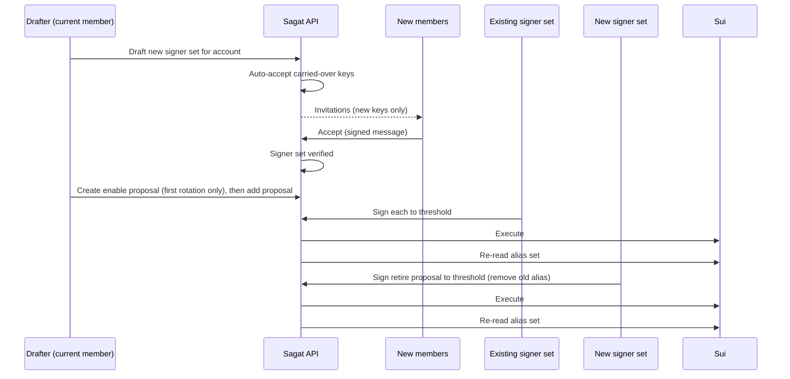

# Account rotation

_Design draft, 2026-09-28. Status: validated on localnet by the phase 0 spike on 2026-10-14, see the spike results in the research note. Builds on [research/address-aliases.md](research/address-aliases.md)._

## Goal

Let a team change who controls a multisig account (members, weights, threshold) **without changing the account's address**. Assets, SuiNS names, `UpgradeCap`s and integrations stay where they are.

This uses Sui address aliases: the account adds the address of a new composition to its alias set, and the new composition can then sign transactions whose sender is the account.

## Vocabulary

| Term                    | Meaning                                                                                                                                                       |
| ----------------------- | ------------------------------------------------------------------------------------------------------------------------------------------------------------- |
| **Account**             | The on-chain address that owns assets and is the `sender` of proposals. Network-agnostic identity.                                                            |
| **Signer set**          | A composition: public keys, weights, threshold. Its address is derived from the composition, so it is immutable and network-agnostic. Today's "multisig" row. |
| **Original signer set** | The signer set whose derived address equals the account address. Not special in storage.                                                                      |
| **Alias set**           | The on-chain set of addresses allowed to sign for an account, **per network**. Defaults to `{account}` when the account never called `enable`.                |
| **Valid signer sets**   | Every signer set whose address is in the account's alias set on a given network. There can be several at once, up to the 8 alias limit.                       |

## Rules the design relies on

1. **One hop.** The signer's address must be in the sender's alias set. The signer's own aliases are not consulted. _Confirmed on localnet, 2026-10-14._
2. **Leaves are public keys.** A multisig member signs with the exact key in the composition. A member's personal aliases never matter.
3. **Aliases are per network.** Rotating on testnet does nothing on mainnet.
4. **Chain is the source of truth.** The alias set can change outside Sagat. The database only mirrors it.
5. **Signatures belong to keys, not to signer sets.** A member signs the transaction bytes with their own key. The signature is the same whichever signer set ends up combining it.
6. **Compositions are immutable.** There is no "edit signer set". A change is a new signer set.

## Data model

**Decision (2026-09-28): clean names now.** Nothing is published yet. The database is renamed to the vocabulary in this doc before the SDK goes to npm. We do not carry the old names behind an ORM mapping. Legacy routes keep working on top of the renamed schema, see the rollout section.

```text
accounts            (address, name, created_at)                        new, explicit
signer_sets         (address, threshold, is_verified, name)            renamed from multisigs; name kept for legacy routes
signer_set_members  (signer_set_address, public_key, weight, order,
                     is_accepted, is_rejected)                         renamed from multisig_members
account_proposers   (account_address, address, added_by, added_at)     renamed from multisig_proposers
proposals           (account_address, network, executed_via, ...)      column renamed, executed_via new
proposal_signatures (proposal_id, public_key, signature)               unchanged
account_aliases     (account_address, network, alias_address)          new, mirror of chain
account_alias_state (account_address, network, exists,
                     observed_version, observed_at)                    new, one row per refreshed network
account_signer_sets (account_address, signer_set_address, label,
                     status, drafted_by, created_at)                   new, account to signer set link; network-agnostic
account_keys        (account_address, public_key, label,
                     updated_by, updated_at)                           0010; what an account calls a key, optional row
account_rotations   (account_address, network, signer_set_address,
                     status, created_at)                               phase 3; per-network progress
```

Alias entries are stored as **addresses**. The resolver classifies each at read time as a known signer set, a single known key, or unknown.

**Decision (2026-10-15): `account_signer_sets` is the link between an account and a signer set**, one row per pair, keyed by `(account_address, signer_set_address)`. The pair had no table of its own. This table replaces the planned `signer_set_drafts`, which already had that primary key and was named after its first use. A composition is content-addressed and can be shared by several accounts, so a label on `signer_sets` would be global and leak between accounts. `signer_sets` therefore has no label; the label is on the pair. Other per-pair facts live here too: who drafted it and its status, and later hiding a retired set, a linked-at time, and the row a person record attaches to. Validity per network is **not** stored here: it stays in the alias mirror and is joined at read time. The status stops at `verified`; linked and retired are computed from the mirror. The one-active-rotation lock is per network, so it stays in its own `account_rotations` table. Every account has a row for its original composition, `(A, A)`, seeded by the migration and written by the create route, with status `verified` when `signer_sets.is_verified` is true and `inviting` otherwise. When the last member of a composition accepts, the legacy accept route flips every pair row of that composition that is still `draft` or `inviting` to `verified`. Rows marked `abandoned` are left alone, so an abandoned draft on one account is never reopened by an acceptance on another.

Draft statuses (`account_signer_sets.status`) are network-agnostic: `draft`, `inviting`, `verified`, `abandoned` (the column defaults to `draft`). Rotation progress is per network in `account_rotations`: `linking`, `linked`, `retiring`, `done`, `abandoned`. A partial unique index on `(account_address, network)` for rows not in `done` or `abandoned` enforces one active rotation per account and network. Both are additive migrations in phase 3.

Why an explicit `accounts` table:

- "Is this composition an account?" becomes a row, not a heuristic.
- Importing a plain address needs no special case later.
- The account name and the label of each of its signer sets are separate. Labels such as "Operations" and "Board" are what the per-set progress display shows.

`account_alias_state` records what the last refresh saw on a network: whether the alias object exists, its version, and when it was read. It separates "never checked" (no state row) from "not rotated" (`exists` is false). An account whose state row says the object does not exist has the alias set `{account}`, and its valid signer set is the signer set with the same address. It has no `account_aliases` rows.

Check constraints limit `account_signer_sets.status` to the draft statuses above and every `network` column in the new tables to `mainnet`, `testnet`, `devnet` and `localnet`. `account_signer_sets` has no separate index on `account_address`: only its primary key, which starts with that column, covers it.

### Migration

One migration, one transaction. It is small because renames are metadata changes and the only data written is two rows per existing multisig: the account and its link to its original signer set.

1. Rename tables and columns as listed above.
2. Create `accounts` and fill it from `signer_sets` with address and name.
3. Point the foreign keys on `proposals` and `account_proposers` at `accounts`.
4. Create `account_aliases`, `account_alias_state` and `account_signer_sets`. Seed one `account_signer_sets` row per account, `(A, A)`, with the multisig name as label and status `verified` or `inviting` from `is_verified`. Add `proposals.executed_via` as nullable.
5. Drop the old `multisig_address_idx` instead of renaming it: it indexes the primary key column.

The migration is hand-written (`api/drizzle/0009_account_rotation.sql`, added in #96, later in this stack). Drizzle's generated SQL was not usable even with every rename answered correctly: it added the foreign keys to `accounts` before filling the table, dropped and recreated indexes instead of renaming them, and never inserted the account rows. Keep the generated snapshot, write the SQL by hand, and prove data preservation on a populated scratch database.

### Rollout

**Decision (2026-10-14): one schema, two route sets, no breaking change.** This replaces the earlier decision to ship a breaking release.

- The database is renamed and the accounts table is added as described above. Legacy routes keep their JSON contract through explicit serializers in `api/src/legacy/serializers.ts`, because the ORM property names change with the columns and the new columns must not leak into old responses.
- The existing routes stay mounted and **frozen**: no field is removed, renamed or changes meaning. Additive fields are allowed when the current product needs them, nullable or always set, each a deliberate regeneration of the golden fixture. Two routes change behaviour: the create route also inserts the account row and its `account_signer_sets` row, so the new API sees what it created, and the accept route flips those link rows to `verified` when the composition is finalized. Fields added so far: `label` on every member object (see per-account key labels below); `draftedBy` and `createdAt` on every multisig object, from the account's `account_signer_sets` row for its original composition, so a client can show who sent an invitation without guessing from the member order; and `currentWeight` on the vote response, the weight collected so far, so a client can show how much a proposal still needs without recomputing it from an earlier read.
- New routes live under a version prefix, `/v1`. Proposals keep their path but change their fields, so the prefix applies to everything new.
- The new SDK targets `/v1` only. The old SDK stays in the repository, unpublished and frozen.
- The session cookie and script token are shared, so a script can move one call at a time.
- Legacy routes **refuse rotated accounts** with a clear error that points at `/v1`. Their response shape describes one composition, and an old client combining signatures from several signer sets would fail anyway. Nobody hits this without having rotated, and rotating happens in the new app. The connection and invitation listings leave rotated accounts out for the same reason. `verify` and `verify-by-digest` are exempt: they only look up the chain state of an existing proposal, so a legacy client that executed an alias change can still verify it after the account counts as rotated. Phase 3, lands with the `/v1` routes.
- Legacy routes are removed when their traffic reaches zero. The request counter already carries a route label, so this is read from metrics, not announced as a date.

Before deploying 0009:

- As a role that owns the tables, `SELECT count(*), max(created_at) FROM drizzle.__drizzle_migrations;` returns 9 rows (the journal through 0008). If not, the database was not built with drizzle migrations: baseline it as described below, deploy with `MIGRATE_ON_START=false` and, as the owner, run `DATABASE_URL=... bun dist/db/migrate-cli.js` in the API image (working directory `/monorepo/api`); from a source checkout, `bun run db:migrate:prod` does the same. Both are added in #101 of this stack: `MIGRATE_ON_START` (on unless set to `false`) makes the API apply pending migrations at startup, and `bun run db:migrate:prod` applies them as a separate step.
- `SELECT DISTINCT tableowner FROM pg_tables WHERE schemaname = 'public';` returns the role the API connects with. Otherwise startup migrations fail on the renames.
- Grant the read-only roles access to `accounts`, `account_signer_sets`, `account_aliases`, `account_alias_state` and, after 0010, `account_keys`, or set default privileges. Otherwise the new tables are invisible to them.
- Anything outside the API that queries `multisigs`, `multisig_members` or `multisig_proposers` by name breaks at the rename. Check dashboards and scripts.
- Deploy with recreate, not a rolling update (see below).

Baselining a database that was not built with drizzle migrations is manual. Drizzle's migrator (drizzle-orm 0.44, node-postgres) records applied migrations in `drizzle.__drizzle_migrations`. It reads the row with the highest `created_at` and applies every entry of `api/drizzle/meta/_journal.json` whose `when` is greater, so an entry counts as applied when a row has `created_at` >= its `when`. The `hash` column is the SHA-256 of the migration's `.sql` file; the migrator stores it but does not compare it. As the owner:

1. Confirm the live schema matches 0008: compare it against `api/drizzle/meta/0008_snapshot.json`, or against what the migration safety test expects of a database at 0008. Do not baseline a database that differs.
2. Create the schema and table as drizzle does:

   ```sql
   CREATE SCHEMA IF NOT EXISTS drizzle;
   CREATE TABLE IF NOT EXISTS drizzle.__drizzle_migrations (id SERIAL PRIMARY KEY, hash text NOT NULL, created_at bigint);
   ```

3. Insert one row per journal entry 0000 to 0008, with `hash` the SHA-256 of the `.sql` file and `created_at` the entry's `when`. From `api/`:

   ```sh
   for f in drizzle/000[0-8]_*.sql; do
     tag=$(basename "$f" .sql)
     when=$(bun -e "console.log(require('./drizzle/meta/_journal.json').entries.find((e) => e.tag === '$tag').when)")
     hash=$(shasum -a 256 "$f" | cut -d ' ' -f 1)
     echo "INSERT INTO drizzle.__drizzle_migrations (hash, created_at) VALUES ('$hash', $when);"
   done > baseline.sql
   psql "$DATABASE_URL" -1 -f baseline.sql
   ```

   The check above now returns 9 rows.

4. Stop here. Do not apply 0009 yet: the database is now baselined through 0008 and the journal says so. 0009 is applied in deployment step 3 below, after the snapshot and after the old API is stopped, by the new API on startup or by `bun dist/db/migrate-cli.js` in the API image (`bun run db:migrate:prod` from a source checkout). Either should apply exactly one migration.

Steps:

1. Publish [migration-guide.md](migration-guide.md).
2. Take a database snapshot.
3. Stop the API, run the migration, start the new API, deploy the new app. Expected downtime is under a minute.
4. Watch legacy route traffic. Remove the routes and the old SDK when it is zero.

The API applies pending migrations on startup. Migration 0009 renames tables, so the previous API version cannot run against the migrated database: deploy it with a stop-and-start (recreate) rather than a rolling update, or expect the old replicas to fail until they are replaced. Migrations after 0009 should be additive (expand, then contract in a later release), so rolling updates keep working.

### Public vocabulary

| Surface         | Change                                                                                                                     |
| --------------- | -------------------------------------------------------------------------------------------------------------------------- |
| API routes      | `/v1/accounts`, `/v1/signer-sets`, `/v1/proposals`. Legacy routes stay, frozen, until traffic is zero.                     |
| API fields      | Under `/v1`: `accountAddress` replaces `multisigAddress`, and single-set fields on proposals are replaced by `signerSets`. |
| SDK             | New package for `/v1`. No deprecated aliases. The old SDK is frozen and never published.                                   |
| Signed messages | Messages that name the account use the new term under `/v1`. Legacy routes keep verifying the old text.                    |
| Metrics         | Names unchanged. They are internal, and dashboards read them. New rotation metrics get new names.                          |
| Exports         | Already carry `type` and `version: 1`. The new app exports version 2. Version 1 stays readable.                            |

The full before and after mapping lives in the migration guide, and is updated in the same pull request as the code.

## Several signer sets at once

An account can have several valid signer sets on a network. Sagat does not pick one.

- **Proposals collect signatures against the account.** Each signature is stored by public key, as today.
- **A proposal is executable when any valid signer set reaches its threshold** with the signatures collected so far. The combined signature is built with that set. When the proposal is verified, the server reads the executed transaction's signature and records which set it was executed via (phase 3, lands with the `/v1` routes).
- **One signature can count toward several sets.** A member whose key is in two sets signs once.
- **Progress is shown per set**, for example "2 of 3 via Operations, 1 of 4 via Board".
- **Every valid signer set has full control of the account.** Aliases cannot be scoped. The account is as secure as its weakest set, and the overview says so whenever more than one set is valid.

Uses this enables: a fast operations set next to a slower board set, a recovery multisig, more than 10 signers in total, and rotations with no forced cut-over.

## The flow



### 1. Draft

- Who: an accepted member of any valid signer set of the account, on any network. Not proposers.
- What: keys, weights, threshold. Same validation as creating a multisig today.
- API: the existing create route, plus the target account. Writes the signer set, its members, and an `account_signer_sets` row with status `draft`.
- If the composition already exists in Sagat, it is reused.
- **One active rotation per account and network at a time** (decided 2026-10-14). Drafting and inviting are network-agnostic and are not locked. A rotation on a network is active from its link proposal until it is retired, kept as a steady state, or abandoned. Starting a second one on the same network is refused with an error naming the one in progress.

### 2. Invite

- Keys with a recorded acceptance (`isAccepted = true`) in a valid signer set of the account are **carried over** and accepted automatically. They already proved possession.
- A member of a valid signer set who never accepted gets a normal invitation. A 2-of-3 whose third member never accepted is still valid, and auto-accepting that key into a 3-of-3 could mark the new set verified with a key nobody holds, which locks the account out once the old set is retired.
- New keys get an invitation and accept with the existing signed message, which references the new signer set's own address.
- The invitation UI shows the account name and a diff: members added, members removed, weight and threshold changes.
- A rejection kills the draft. Draft a new one.

### 3. Gate

The link proposal can only be created when the signer set is **verified**, meaning every key has accepted. This reuses today's finalized flag and guarantees every key in the new set has produced a signature at least once.

### 4. Link (per network)

- A normal proposal with `sender = account`, executed once any valid signer set reaches threshold.
- PTB: `address_alias::add(new_signer_set_address)`.
- **`enable` is a separate transaction, not a command in the same PTB.** The alias object does not exist until `enable` executes, and `add` needs it as an input, so the first rotation of an account is two proposals: an enable proposal, then the add proposal. The spike confirmed a combined PTB fails to build. The wizard presents this as one flow with two signing rounds.
- The alias calls must be **top-level PTB commands**. The builder emits exactly these commands and nothing wrapped.
- The alias object is **party-owned** (consensus address owner), not a plain owned object. The SDK resolves it as a shared input, consensus orders the transactions and assigns versions, so the alias object input of a pending alias proposal never goes stale on version and needs no collision check. That holds for the alias object only: the gas coin is an owned object of the account, so two pending proposals that pay with the same gas coin still collide, and the existing gas-coin collision check (`validateProposedTransaction` in `api/src/services/multisig.service.ts`) applies to alias proposals like any other. Apart from gas, a second alias proposal on the same account and network only aborts if the first made it meaningless (duplicate add, repeated remove, ninth alias). Rotations themselves are limited to one active per account and network, see the draft step.
- After execution the account has one more valid signer set on this network. Nothing is switched off.

### 5. Retire the old set (per network)

- A proposal with `address_alias::remove(old_signer_set_address)`.
- **Only accepted when a verified signer set would remain on that network.** When the proposal is created, Sagat takes the alias set from the mirror and computes what would remain after this removal and after every other pending alias-removing proposal of the same account and network in Sagat's database, as if all of them execute. It refuses the proposal if no verified signer set would remain. Phase 3, lands with the `/v1` routes.
- **The check and the insert are one transaction, serialized per account and network** (a Postgres advisory lock on the pair, the same pattern the alias refresh uses). Two retire proposals created at the same time therefore see each other, and the second is refused. The set of pending alias-removing proposals counts every pending proposal whose PTB calls `address_alias::remove` or `address_alias::replace_all` on the account, found with the alias-call detector, whether it came from the wizard or was written by hand.
- What Sagat guarantees: when a retire proposal is created, neither it alone nor it together with the alias-removing proposals already pending in Sagat can leave the account without a verified signer set according to the mirror.
- What it cannot, by decision: manual alias proposals are never refused (see Safety rails), so a hand-written `remove` or `replace_all` created after a retire proposal passed its check can still combine with it into a lockout. Such a proposal gets the prominent preview warning, and the pending retire proposals are listed next to it. Nor can Sagat prevent a lockout caused by alias changes made outside Sagat between creation and execution: signatures are public and clients combine them, so Sagat cannot check which set executes the proposal or what executed before it. Such changes show up at the next refresh.
- On execution the old set stops being valid on this network.
- Retiring is optional. Keeping several sets is a supported steady state.

### 6. Refresh

There is no background job. Sagat re-reads the alias set from chain through one refresh function, which updates the mirror and returns what changed. It runs when an account page is opened, when a proposal is created or signed, before execution, and right after a link or retire proposal executes. A change made outside Sagat is therefore noticed the next time anyone touches the account, and shown as a warning on the overview.

An access check on a network whose state row is missing (never refreshed) or older than a minute triggers a refresh first and decides on its result. It refuses only when the refresh itself fails. A key removed from the alias set outside Sagat therefore loses access within a minute. Access checks are per network; only network-agnostic reads, such as the account overview and invitations, use the union across networks.

## Pending proposals during a rotation

| Moment                    | Effect on pending proposals                                                                                                                                                                                  |
| ------------------------- | ------------------------------------------------------------------------------------------------------------------------------------------------------------------------------------------------------------ |
| After enable              | Unchanged. The alias set is still `{account}`.                                                                                                                                                               |
| After link, before retire | Still valid. The old set is still an alias.                                                                                                                                                                  |
| After retire              | Signatures from keys that are still in a valid signer set keep counting. Signatures from removed keys are dropped. A proposal only needs more signatures if it falls below threshold in every remaining set. |

The retire screen lists pending proposals and recommends executing or cancelling them first. It does not block.

The client picks a signer set that reached threshold from the mirrored alias set, which is refreshed on the usual schedule (see step 6). Clients combine signatures, so Sagat cannot control which set is used. If the chain disagrees, the node rejects the transaction before execution with no gas charged, and the error message lists the account's current alias set; Sagat then refreshes. That message is usable in the "proposal lost signatures" display.

## Networks

- Valid signer sets are tracked per account and network.
- The wizard creates one link proposal and one retire proposal **per network**, each executed independently.
- Recommended path: rehearse on testnet, then mainnet.
- **Divergence is shown, not hidden.** If networks disagree on who controls the account, the overview says so on every network. The dangerous case is believing a rotation happened when it only happened on testnet.
- The original signer set is only the default. If the account removed itself from its alias set on a network, the original set is invalid there.

## Safety rails

Sagat is defensive about what it controls: the accuracy of the mirror, access decisions, the wizard, and never building a lockout. It does not try to prevent mistakes made outside it, such as a signer set Sagat does not know being added manually, or signatures combined and executed outside Sagat. Those are detected at the next refresh and shown.

- No `replace_all` in the wizard. Only `enable` (first time), `add`, then `remove`, each as a separate proposal.
- Manual proposals that call `0x2::address_alias` are allowed on every route. The transaction preview shows a prominent "this changes who controls the account" warning, and calls out `replace_all`. The rotation wizard is the guided path, not the only path, and the one-active-rotation lock applies to wizard flows only. Once an account counts as rotated, the phase 3 legacy gate refuses it on legacy routes, except `verify` and `verify-by-digest`: they only look up the chain state of an existing proposal, so a legacy client that executed an alias change can still verify it. After any alias change executes, the mirror picks it up on the next refresh.
- A different gas owner needs its own signature, which Sagat does not collect, so such proposals fail at execution. The preview warns.
- Dry-run both proposals and show the resulting alias set before signing.
- Never build a `remove` that would leave the account with no alias Sagat can resolve to known keys, unless the user types an explicit acknowledgement. The acknowledgement exists for the standalone alias tool (for example removing a recovery key the team no longer recognises). It does not override the wizard's retirement guard in step 5: a wizard retire that would leave no verified signer set is refused, with no acknowledgement path.
- Maximum 8 aliases. The wizard checks headroom before drafting.
- After a refresh, aliases that are not known signer sets or keys, and any change not made through Sagat, are shown as a warning on the overview. There is no acknowledgement state.

## Scope

**Decision (2026-09-28).** This work covers rotation only: the schema rename, the `/v1` API and SDK, accounts, several signer sets per account, the link and retire flow, and per-network alias state.

Out of scope: notifications, channels, persons, a background chain watcher, and an event outbox.

### Room left for later

Each of these is a property of the rotation design, not extra work. Together they mean the out of scope items can be added without reshaping anything.

| Later feature        | What the rotation design already provides                                                                                           |
| -------------------- | ----------------------------------------------------------------------------------------------------------------------------------- |
| Notifications        | The resolver returns the leaf public keys for an account and network. That list is the recipient list.                              |
| Chain watcher        | The refresh function takes an account and network, updates the mirror, and returns a diff. A scheduler can call the same function.  |
| Alias changed alerts | The diff from the refresh function is the event. The state row keeps the observed version and time.                                 |
| Event outbox         | Rotation state changes go through one recording function. Today it only updates metrics. Later it also writes a row.                |
| Persons              | Audit fields stay as addresses. Nothing is keyed on the group of keys in a browser session. No contact details are stored anywhere. |
| Per-network anything | Every alias row, proposal, and recorded change carries the network.                                                                 |

Rules that keep this true while building:

1. Signer resolution lives in one service. Routes never read alias rows directly.
2. Alias state is written only by the refresh function.
3. States such as "proposal lost signatures" and "networks diverge" are computed on read, not stored.
4. New rotation code records changes through the single recording function. Existing inline metric calls are left alone unless the code around them is already being changed.

### Per-account key labels (0010, shipped)

Teams want to name the keys in a signer set ("Alice's Ledger"). The label belongs to the account and public key, not to the signer set member row: a key carries over across rotations, and a composition can be shared by several accounts, so a label on the member row would have to be re-entered per set and would leak between accounts. `account_keys` is keyed by account address and public key, with `label`, `updated_by` and `updated_at`. The table is named after the pair, not the label, because the same row later takes a role, a last-active time, and the link to a person record; each is one nullable column, and the name stays true (decided 2026-10-15).

Decisions (2026-10-19):

- **Labels are optional.** No row is required per key. The create route takes an optional `labels` array aligned with `publicKeys`; null and blank entries are skipped, the rest are trimmed and limited to 64 characters. Only labelled keys get a row.
- **Set at creation only.** There is no update route. Creating an account labels its keys. When the rotation wizard lands (phase 3), drafting a new signer set is meant to be the second creation step: it labels any new keys, while keys the account already knows keep their row. Whether to add renaming later is an open question; `updated_by` and `updated_at` are what such a route would write.
- **Legacy routes show them, authenticated only.** Every member object in the legacy multisig responses carries `label: string | null`, joined from the account with the same address. This is the one additive field on the frozen routes. Labels are never returned on an unauthenticated route: the public proposal-by-digest lookup keeps its member shape (key, weight, order), and a test asserts it. Labels reach a response only through the legacy serializer, which is called by the four routes behind `authMiddleware` (get multisig, create, connections, invitations).
- The label is inside Sagat's control, so the create route refuses a `labels` array that does not line up with the keys, and refuses control and formatting characters (bidi overrides, zero-width characters) that could spoof what sits next to a key. Only a caller who is a member of the composition may label it: anyone holding a key can still set up a multisig for others, but an outsider must not plant labels that nobody can change. It does not try to keep labels unique.

## Edge cases

| Case                                                | Behaviour                                                                                                                                                   |
| --------------------------------------------------- | ----------------------------------------------------------------------------------------------------------------------------------------------------------- |
| Same members, new threshold or weights              | Keys that had accepted carry over, already accepted. A member who never accepted the old set is invited. Verified instantly only if every key had accepted. |
| Removing one member                                 | Same as above, minus that key. The removed key can still sign until retire executes.                                                                        |
| A member replaces their own key                     | New key is invited and accepts. The old key is dropped from the new signer set.                                                                             |
| Composition already exists as a standalone multisig | Reused. It is both an account and a signer set for another account.                                                                                         |
| Draft never linked                                  | Stays a draft. Does not appear on the dashboard as an account.                                                                                              |
| Account has a recovery alias (single key)           | Shown as an alias. It can sign alone for the account. Untouched by rotation.                                                                                |
| Unknown alias appears                               | Shown as unlinked signer with a warning.                                                                                                                    |

## Changes to existing code

- **Limits.** The cap of multisigs per public key counts accounts, not signer sets.
- **Membership checks** in the current multisig service and proposal routes go through the signer resolver with account and network.
- **Execution hook** in the app picks a valid signer set that has reached threshold and builds the combined key from it.
- **Invitations page** gains the rotation context and diff.
- **Dashboard** lists accounts. Signer sets are visible inside an account.
- **API routes and SDK** are added under `/v1` with the account and signer set vocabulary. Legacy routes stay frozen. See the rollout section.

## Open decisions

1. **Auto-accept carried-over keys, or require explicit consent from everyone?** Auto-accept is proposed. The protection is that linking still needs threshold signatures from the current set.
2. **Should Sagat nudge teams to retire old sets** after a rotation, or treat several sets as a normal steady state?
3. **Proposers per network**, or account-wide as today?
4. **Weakest set warning.** Warn only, or let an account set a minimum threshold policy that new signer sets must meet?
5. **User-facing words.** The code says account and signer set. Whether the interface says "signer set", "signers", or "signer group" is a separate wording decision.
6. **Alias login.** Should Sagat accept authentication as an address when signed by one of its alias keys?

## Validation needed before building

Testnet spike, in this order:

All five steps passed on localnet on 2026-10-14 (sui 1.81.1, protocol 138). The test (`api/test/address-aliases.test.ts`) and the helpers (`api/src/utils/aliases.ts`) are added in #95, the next PR of this stack. Full results are in the research note.

1. Multisig account calls `enable`, then `add` with a second composition's address.
2. Transaction with `sender = account` signed by the second composition executes.
3. Confirm the one-hop rule: give the second composition its own alias and check that alias cannot sign for the account.
4. Second composition executes `remove` of the original. Confirm the original can no longer sign.
5. Confirm the alias object id derivation and BCS decoding from the research note.

## Phase 2 notes

- **Refresh diff is between effective sets.** No alias rows counts as `{account}`, so the first refresh after `enable` reports no change instead of "added account".
- **Alias order is not mirrored.** `account_aliases` has no position column, so the mirror returns aliases sorted by address. `refreshAliases` returns the chain's insertion order. Add a column if the interface needs that order.
- **Signer set events have no network.** Signer sets and drafts are network-agnostic, so `signer_set_drafted` and `signer_set_verified` are recorded with the network label `all`. Alias events always carry the network.
- **Refresh never moves the mirror backwards.** If a fullnode serves an older object version than the mirror holds, the refresh writes nothing. The same holds when the node reports the alias object as missing after a refresh saw it: the object cannot be deleted, so the node is lagging or wrong. On mainnet and testnet this guard protects access decisions: a stale read can never re-grant access to a removed signer set.
- **Known limitation on networks that reset (decided 2026-10-15).** Devnet and localnet start over from genesis, and after a reset the alias object is missing or back at a lower version. The guard above then keeps the old mirror. This is accepted as a development-only limitation rather than solved with a chain identifier column: after a devnet reset or a localnet regenesis, stop every API instance, clear `account_aliases` and `account_alias_state` for that network in one transaction, and start the API again. Stopping first matters: a refresh in flight can read the pre-reset object and write after the cleanup, and the guard then rejects the real post-reset state. The API README gets the command in the services PR (#98); until then, with every instance stopped, run `BEGIN; DELETE FROM account_aliases WHERE network = '<network>'; DELETE FROM account_alias_state WHERE network = '<network>'; COMMIT;`. Mainnet and testnet never reset.
